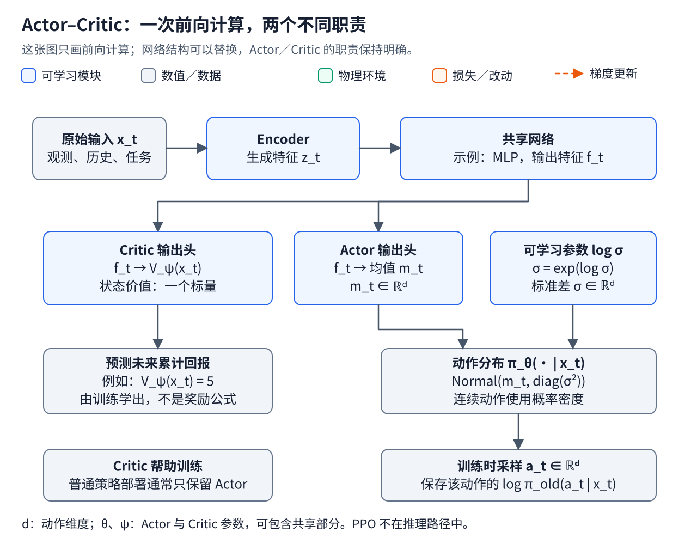
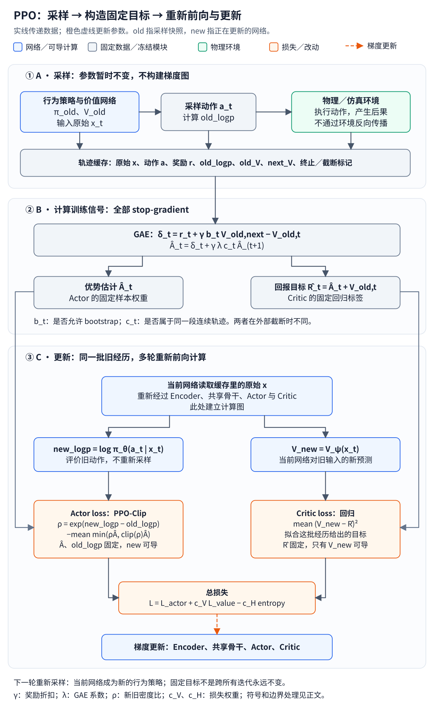

# RL 基础：从 Actor–Critic 到 PPO 的数据、目标与梯度

> 阅读位置：[灵巧手研究地图 RL01](43_dexterous_rl_overview.md) → 本文 RL02 → [Teacher–Student 与部署 RL03](45_teacher_student_and_sim_to_real.md) → [HORA 精讲 RL04](46_hora_paper_walkthrough.md)。本文讲通用原理；HORA 的维度、物体分布、奖励实现和实验结论放在 RL04。

强化学习的入门难点往往在几个接口：模块叫什么、网络输出什么、训练目标从哪里来，以及梯度究竟更新谁。本章沿着“环境交互 → 价值预测 → 动作评价 → 策略更新”的顺序组织这些概念。理解主线后，再进入部分可观测、特权信息和真实部署。

## 1. 从动作标签到交互结果

行为克隆用专家提供的观测—动作配对训练策略。使用 flow matching 的动作模型，也可以从示范动作和采样噪声构造速度场目标；目标的正负号取决于插值路径与时间方向。两者都能从数据构造明确的动作学习目标，背景见 [模仿学习基础](23_imitation_learning_basics.md) 与 [Flow Matching](10_flow_matching_training_and_inference.md)。

RL 的任务信号来自执行动作后的结果。环境按照奖励规则返回一个数，算法再用一段经历评价动作的后续影响。没有专家动作标签，并不意味着没有训练目标：价值目标和策略损失可以由交互数据构造。

| 层次 | 职责或例子 | 需要区分的内容 |
| --- | --- | --- |
| 模块职责 | Encoder、Actor、Critic | 提取信息、产生动作、预测价值 |
| 网络架构 | MLP、CNN、LSTM、Transformer | 模块如何用可学习函数实现 |
| 学习算法 | PPO、SAC、行为克隆 | 用什么数据与目标更新参数 |
| 数值优化器 | Adam、SGD | 根据梯度怎样更新参数 |
| 训练组织 | Teacher–Student、课程、分阶段训练 | 多个模型与训练阶段如何配合 |
| 任务信号 | 目标奖励、tracking 奖励、示范标签 | 怎样定义任务以及提供先验 |

“用 PPO 训练一个 MLP Actor，再用动作监督训练视觉 Student”包含三个层次。换网络不自动换算法；Student 的 Teacher 来自 RL，也不使 Student 的监督训练自动变成 RL。

## 2. 环境、状态、观测与动作

完全可观测的 Markov 决策过程可写为：

\[
\mathcal M=(\mathcal S,\mathcal A,P,r,\rho_0,\gamma).
\]

| 符号 | 含义 | 机器人中的对应 |
| --- | --- | --- |
| \(t\) | 环境交互时间步 | 一次控制周期 |
| \(\mathcal S,s_t\) | 状态空间与当前完整状态 | 决定动力学的手、物体及环境信息 |
| \(\mathcal A,a_t\) | 动作空间与策略采样的动作 | 关节增量、速度或力矩等 |
| \(P(s_{t+1}\mid s_t,a_t)\) | 状态转移分布 | 接触动力学、执行器、随机扰动 |
| \(r,r_t\) | 奖励函数及其本步输出 | 旋转进展、稳定性、掉落代价 |
| \(\rho_0\) | 初始状态分布 | 从已抓持状态或桌面状态开始 |
| \(\gamma\in[0,1]\) | 折扣因子 | 后续奖励在当前目标中的相对权重 |
| \(o_t\) | 机器人可获得的观测 | 关节读数、图像、触觉 |
| \(H_t\) | 观测与过去动作组成的历史 | 用于估计遮挡、滑移和隐藏动力学 |
| \(x_t\) | 本文统一使用的网络输入 | 可以是 \(o_t\)、历史、目标，或训练时的特权信息 |
| \(u_t\) | 送到底层执行器的实际命令 | 对 \(a_t\) 做限幅、缩放、积分之后的位置目标等 |

在完全可观测推导中，价值函数以 \(s_t\) 为条件。代码中的网络往往只读 \(x_t\)，因此是在可用信息上近似估计价值；增加历史不保证所有隐藏物理量都能恢复。后文将网络输出写为 \(V_\psi(x_t)\)，不默认 \(x_t\) 等于完整状态。

动作的随机采样值与真实命令也应分开。如果执行前将高斯样本限幅，缓存原始样本的 log probability 时，更新阶段也应评价同一个原始样本，不能把限幅后的值直接代入原高斯分布当作采样记录。具体控制合同见 [机器人数据与动作语义](24_robot_data_action_semantics.md)。

## 3. 网络前向：Actor 产生动作，Critic 预测回报

[打开可放大的 Actor–Critic 矢量图](../assets/figures/rl-actor-critic-architecture.svg)。蓝色表示网络与可学习参数。此图只说明一次前向计算；PPO 的采样、训练目标和反向更新在第 6 节单独展开。

### 3.1 Actor 是策略的可学习实现

随机 Actor 定义条件动作分布：

\[
a_t\sim\pi_\theta(\cdot\mid x_t).
\]

\(\pi\) 是策略，\(\theta\) 是决定策略输出的可学习参数，点号表示动作变量的位置。确定性 Actor 则直接输出动作。Actor 这个名称规定职责，不规定必须使用哪种网络。

连续控制常用对角高斯分布：

\[
\pi_\theta(\cdot\mid x_t)
=\mathcal N\!\left(m_\theta(x_t),\operatorname{diag}(\sigma^2)\right),
\qquad
a_t=m_\theta(x_t)+\sigma\odot\xi_t,\quad
\xi_t\sim\mathcal N(0,I).
\]

这里 \(m_\theta\) 是动作均值向量；\(\sigma\) 是标准差向量；\(\odot\) 是逐元素乘法；\(I\) 是单位矩阵；\(\operatorname{diag}\) 把向量放到矩阵对角线上；\(\xi_t\) 是探索噪声。标准差可以是单独的可学习参数，也可以由网络根据输入预测。实践中常学习 \(\log\sigma\)，再取指数保证标准差为正。

连续动作下，\(\pi_\theta(a_t\mid x_t)\) 是概率密度，不是“恰好执行某个浮点向量”的概率。提高某个已采样动作的密度，直观上是在改变以后相似情形下的动作分布。训练时可以采样，部署时是否取均值由实现决定。

### 3.2 Critic 是价值回归网络

使用状态价值的 Critic 输出一个标量：

\[
\hat V_t=V_\psi(x_t).
\]

\(\psi\) 是价值网络的参数，\(\hat V_t\) 是一次前向预测。网络读当前可用信息，不在内部真正执行未来轨迹。若最后一层是线性层，输出就是：

\[
\hat V_t=w_V^\top f_t+b_V.
\]

\(f_t\) 是骨干提取的特征；\(w_V,b_V\) 是价值头的权重和偏置。所谓“原本预期 5 分”，只是这次前向输出了 5；它不是预置分数，也不是仿真器提前告诉网络的答案。

Actor 与 Critic 可以共享 Encoder 和骨干，也可以完全分开。共享部分同时受到两个损失的影响。本文用 \(\theta,\psi\) 区分职责，但不意味着两组参数一定不相交。

PPO 常用 \(V\) Critic；SAC 等方法常用以状态和动作为输入的 \(Q\) Critic。不能把“Critic 输出价值”理解成所有算法都输出每个动作的 Q 值。

### 3.3 架构由输入和记忆需求决定

| 输入／职责 | 常见或可选实现 |
| --- | --- |
| 质量、尺寸、关节状态等固定维度数值 | MLP |
| RGB、深度、触觉图像 | CNN、ResNet、ViT 等 |
| 三维点集 | PointNet、PointNet++ 等 |
| 一段运动历史 | 时间卷积、LSTM／GRU、Transformer |
| 编码后的特征到动作或价值 | MLP 与线性输出头，也可结合循环或注意力结构 |

例如 [DexPoint](https://proceedings.mlr.press/v205/qin23a/qin23a.pdf) 使用 PointNet 编码点云，再接 Actor／Critic MLP，并用 PPO 训练。MLP 是低维控制的常见实现，不能据此给整个灵巧手领域下未经统计的“多数都是 MLP”的结论。上述策略与价值概念可对照 [OpenAI Spinning Up](https://github.com/openai/spinningup/blob/master/docs/spinningup/rl_intro.rst)。

## 4. 从环境奖励到 Return、V、Q 与 Advantage

### 4.1 实际经历和预测值

环境先计算每一步的奖励，再由轨迹得到折扣回报：

\[
r_t=r(s_t,a_t,s_{t+1}),\qquad
G_t=\sum_{k=0}^{T-t-1}\gamma^k r_{t+k}.
\]

\(T\) 是这段完整回合的终点，\(k\) 是向后数的时间偏移。\(G_t\) 依赖这一次实际发生的奖励序列。理论价值函数则是期望：

\[
V^\pi(s)=\mathbb E_\pi[G_t\mid s_t=s],
\qquad
Q^\pi(s,a)=\mathbb E_\pi[G_t\mid s_t=s,a_t=a],
\]

\[
A^\pi(s,a)=Q^\pi(s,a)-V^\pi(s).
\]

| 量 | 职责 | 是否是网络必需的独立输出 |
| --- | --- | --- |
| \(r_t\)：reward | 单步任务反馈 | 通常由环境计算 |
| \(G_t\)：return | 一次经历中的未来折扣奖励之和 | 不是 |
| \(V^\pi\)：state value | 按该策略继续行动的预期回报 | PPO 用 \(V_\psi\) 近似 |
| \(Q^\pi\)：action value | 先指定当前动作，再按该策略继续行动的预期回报 | PPO 不必训练独立 Q 网络 |
| \(A^\pi\)：advantage | 指定动作相对该状态下策略平均表现的优势 | 通常从轨迹估计 |
| \(\hat A_t\) | 有限数据算出的 advantage 估计 | 作为策略损失中的固定权重 |
| \(\hat R_t\) | 代码常称 returns 的回报估计／价值目标 | 作为 Critic 的固定回归目标 |

\(\mathbb E_\pi\) 表示对按策略执行产生的随机经历取期望。理论上的 \(V^\pi\) 与网络输出 \(V_\psi\) 需要区分；后者可能不准。带帽子的量是估计，不代表精确真值。

策略希望提高的总体目标是 \(J(\theta)=\mathbb E_{\pi_\theta}[G_0]\)，即从任务初始分布出发的预期回报；\(J\) 表示这个目标函数。后面的 PPO loss 是根据有限采样构造的优化目标，降低一次 minibatch loss 并不保证实际任务回报每次都严格增加。

一个 16 维手部动作通常对应一个 reward、一个 \(V\) 和一个 advantage 标量，评价的是整次协调动作的后续影响，不是给每根手指单独贴一个“正确动作”标签。

### 4.2 Critic 的训练数据由交互产生

先考虑使用完整回报作为目标的简单版本：

\[
\mathcal L_V=\mathbb E\big[(V_\psi(x_t)-G_t)^2\big].
\]

假设一条经历给出 \(G_t=8\)，网络原本输出 5。预测改为 6 时，这条样本的平方误差从 9 降到 4；改为 7 时降到 1。梯度下降因而推动预测接近目标 8。

这不是“老策略实际 return 与新策略实际 return 做 loss”。更新期间固定的是采样得到的目标，变化的是当前网络的预测。当前 Critic 在拟合这批行为策略的数据；下一轮再收集新策略的数据，持续跟随策略变化。

同样的状态可能因探索与扰动得到不同回报，Critic 应从许多样本学条件期望。一次拿到 8，不证明这个状态的真实期望永远等于 8。随机初始化的 Critic 最初也不准；它与 Actor 在交互训练中一起学习，不需要预先准备一个完美的价值模型。

### 4.3 Actor 使用结果调整未来的选择倾向

简单的优势估计是：

\[
\hat A_t=G_t-V_{\mathrm{old}}(x_t).
\]

前例中 \(8-5=+3\)。这条样本告诉 Actor：这次尝试带来的后续结果高于原先预期。若回报为 2，则优势为 \(-3\)。正负号影响增加还是减少该动作在同类输入下的概率密度。

“调整已执行动作的概率”指更新后网络对旧样本动作的评分，从而改变未来选择。过去的物理动作不会改变。单个样本受后续动作和随机性影响，因此这是统计学习信号，不是一次试验对动作优劣的确定判决。

## 5. 用三步轨迹连接即时奖励与长期效果

以下是独立教学数据，数字不是任何论文的指标或归一化值。取 \(\gamma=0.9\)，三步后真正终止：

| 时间 \(t\) | 当前 reward \(r_t\) | 采样时 Critic 预测 \(V_{\mathrm{old}}\) | 完整 return \(G_t\) | \(G_t-V_{\mathrm{old}}\) |
| --- | --- | --- | --- | --- |
| 0 | 0 | 0.40 | \(0+0.9\times0+0.9^2\times1=0.81\) | 0.41 |
| 1 | 0 | 0.50 | \(0+0.9\times1=0.90\) | 0.40 |
| 2 | 1 | 0.60 | 1.00 | 0.40 |

第 0 步没有即时奖励，仍然有正的学习信号，因为后续取得了收益。这能解释换指、重新接触等动作：局部变化不一定立刻获得奖励，但可能支持后续任务完成。

这张表使用完整轨迹。实际 PPO 经常只收集有限长度的片段，需要用价值预测补充尚未看到的后续回报，这称为 bootstrap。

## 6. PPO 的三段闭环：采样、固定目标、重新前向

[打开可放大的 PPO 完整训练图](../assets/figures/rl-ppo-training-loop.svg)。灰色块在一轮更新期间固定；蓝色块是网络及当前可导输出；绿色块是环境；橙色块是损失。数据流和虚线参数更新是两种不同的箭头。

| 阶段 | 执行内容 | 哪些量随后固定 |
| --- | --- | --- |
| A：rollout | 当前 Actor 采样，环境返回 reward，保存原始输入、动作和价值预测 | 旧动作、旧 log probability、旧价值、奖励及边界信息 |
| B：目标估计 | 用奖励与旧价值计算 GAE 和 Critic 目标 | \(\hat A_t,\hat R_t\)，不保留反向计算图 |
| C：minibatch 更新 | 当前网络重新处理旧输入，评价旧动作，计算 Actor／Critic loss | 分母旧概率与训练目标不随优化步骤改动 |

这里 old 指“收集这批数据时的参数与预测”，new 指“更新过程中当前参数下重新算出的预测”。不需要先让新策略重新跑出一条轨迹才能计算本轮 loss。

PPO 可以在同一批数据上更新多个 epoch，然后重新采样。它属于 on-policy 方法，不意味着一批数据只能使用一次。PPO 是整个采样与优化规则，不是插在 Encoder 和动作之间的推理层。[PPO 原论文](https://arxiv.org/abs/1707.06347)

## 7. GAE：从旧价值与奖励构造两个训练量

### 7.1 TD 残差和反向递推

在尚未遇到回合边界的位置：

\[
\delta_t=r_t+\gamma V_{\mathrm{old}}(x_{t+1})-V_{\mathrm{old}}(x_t),
\qquad
\hat A_t=\delta_t+\gamma\lambda\hat A_{t+1}.
\]

\(\delta_t\) 是 TD 残差：已经看到的一步奖励加上对未来的估计，减去原先的预测。\(\lambda\in[0,1]\) 是 GAE 的衰减系数，用于权衡优势估计的偏差与方差。展开后：

\[
\hat A_t=\delta_t+(\gamma\lambda)\delta_{t+1}
+(\gamma\lambda)^2\delta_{t+2}+\cdots.
\]

代码中的价值目标通常构造为：

\[
\hat R_t=\hat A_t+V_{\mathrm{old}}(x_t).
\]

因此，advantages 与 returns 不是两个额外网络的输出，而是从数据计算的两组标量。advantages 用来加权策略更新，returns 用来监督价值预测。[GAE 原论文](https://arxiv.org/abs/1506.02438)

第 5 节的轨迹得到 \(\delta=(0.05,0.04,0.40)\)。取 \(\lambda=1\)，递推得到 \(\hat A=(0.41,0.40,0.40)\)，与完整回报减旧价值一致。若取 \(\lambda=0.95\)，则：

\[
\hat A=(0.37661,\ 0.382,\ 0.4),\qquad
\hat R=(0.77661,\ 0.882,\ 1.0).
\]

此时 \(\hat R\) 已不是简单的完整奖励累加，因而不应把所有代码中名为 returns 的张量都当作精确 Monte Carlo return。

### 7.2 真正终止、外部截断和采样片段结束

终止处理决定训练目标是否正确。令：

\[
b_t=1-\mathbf1[\mathrm{terminated}_t],\qquad
c_t=1-\mathbf1[\mathrm{terminated}_t\lor\mathrm{truncated}_t].
\]

\(\mathbf1\) 是指示函数；\(b_t\) 控制是否 bootstrap；\(c_t\) 控制 GAE 是否跨到下一条数据。更完整的递推为：

\[
\delta_t=r_t+\gamma b_t V_{\mathrm{old}}(x_{t+1})
-V_{\mathrm{old}}(x_t),\qquad
\hat A_t=\delta_t+\gamma\lambda c_t\hat A_{t+1}.
\]

| 边界 | 是否利用最后状态的价值 | 是否把下一回合的 GAE 接进来 |
| --- | --- | --- |
| 任务真正终止，例如任务定义中的掉落失败 | 否 | 否 |
| 外部时间上限截断，但任务本来会继续 | 是 | 否 |
| 只是本轮 rollout 长度用完，环境未重置 | 是 | 本片段尾部递推设为 0 |

截断时要读取 reset **之前**最后观测的价值，不能读取新回合初始状态来 bootstrap。如果有限时间终点本身就是任务定义的一部分，则应按真正终止处理；还可能需要将剩余时间纳入状态。[Gymnasium 时间限制说明](https://gymnasium.farama.org/tutorials/gymnasium_basics/handling_time_limits/)

## 8. 两个 Loss：预测准确与改变动作分布

### 8.1 Critic 回归固定目标

\[
\mathcal L_V=\frac1N\sum_{i=1}^{N}
\left(V_\psi(x_i)-\operatorname{stopgrad}(\hat R_i)\right)^2.
\]

\(N\) 是 minibatch 样本数，\(i\) 是样本索引，stopgrad 表示目标不参与反向传播。当前价值预测可以更新，目标不会跟着预测一起移动。某些 PPO 实现还对价值更新做 clipping；这不改变回归目标的基本职责。

### 8.2 Actor 根据优势改变旧动作的概率

令 \(\ell_i^{\mathrm{old}}\) 为采样时保存的 log probability，\(\ell_i^{\mathrm{new}}\) 为当前网络对**同一个旧动作**重新计算的 log probability：

\[
\ell_i^{\mathrm{old}}=\log\pi_{\mathrm{old}}(a_i\mid x_i),
\quad
\ell_i^{\mathrm{new}}=\log\pi_\theta(a_i\mid x_i),
\quad
\rho_i=\exp(\ell_i^{\mathrm{new}}-\ell_i^{\mathrm{old}}).
\]

\(\rho_i\) 是新旧概率密度比，与第 2 节的初始状态分布 \(\rho_0\) 不是同一个对象。PPO-Clip 最小化的策略损失为：

\[
\mathcal L_\pi=
-\frac1N\sum_{i=1}^{N}
\min\!\left(
\rho_i\hat A_i,
\operatorname{clip}(\rho_i,1-\epsilon,1+\epsilon)\hat A_i
\right).
\]

\(\epsilon\) 是裁剪阈值。clip 在特定更新方向上取消进一步增大目标的收益，不保证所有状态的策略变化都严格落在一个范围内，也不是对机器人动作幅度做限幅。

用离散概率解释未触发裁剪时的方向：一条样本的旧动作概率为 0.20，未标准化优势为 \(+3\)，则其损失项为 \(-3p_{\mathrm{new}}/0.20\)。

| 当前概率 \(p_{\mathrm{new}}\) | 概率比 | 这条样本的 loss |
| --- | --- | --- |
| 0.18 | 0.9 | -2.7 |
| 0.20 | 1.0 | -3.0 |
| 0.22 | 1.1 | -3.3 |

优化器最小化 loss，因此该样本推动动作概率增加。若优势是 \(-3\)，降低概率反而降低 loss。连续高斯策略改变的是分布参数与相应密度，不能把表中的百分比当作 HORA 对一个精确动作向量的概率。

### 8.3 总损失与梯度边界

一个常见的组合形式是：

\[
\mathcal L=\mathcal L_\pi+c_V\mathcal L_V-c_H\mathcal H(\pi_\theta).
\]

\(c_V,c_H\) 是损失权重；\(\mathcal H\) 是策略熵，正权重的熵奖励鼓励分布保留探索。图中的 H 表示历史，花体 \(\mathcal H\) 表示熵，二者不同。具体实现可以增加其他正则项。

| 路径 | 是否反向传播 |
| --- | --- |
| 当前 log probability → Actor → 上游 Encoder／共享骨干 | 是 |
| 当前 value → Critic → 上游 Encoder／共享骨干 | 是 |
| advantage、return target、旧 log probability、旧 value | 本轮作为固定数据，不反传 |
| 已执行动作 → 真实接触或物理仿真 | PPO 不沿这条路径反传 |

因此 Encoder 可以被 PPO 端到端训练：更新时重新输入原始观测，损失经过网络传回 Encoder。只使用已断开计算图的缓存 latent，则不能由这条路径更新原始 Encoder。[PPO 目标与实现说明](https://github.com/openai/spinningup/blob/master/docs/algorithms/ppo.rst)

## 9. 将图 A／B／C 对应到伪代码

以下是单环境 PyTorch 风格的教学流程，不是某篇论文的逐行复刻。所有输入已转成张量；环境由调用方显式 reset，step 返回的是 reset 前的下一观测。并行环境、归一化、设备管理和日志省略。

### 9.1 一次网络前向

~~~python
def forward(x):
    features = backbone(encoder(x))
    mean = actor_head(features)             # [action_dim]
    std = log_std.exp()                     # 可学习参数，或另一个网络输出
    dist = Independent(Normal(mean, std), 1)
    value = critic_head(features).squeeze(-1)  # 一个标量
    return dist, value
~~~

Independent 将动作维度合成一个联合分布，因此 log_prob(action) 返回整次动作的一个标量。Encoder、骨干、两个头和 log_std 都属于 model 的参数；上面只是把 forward 内容展开。

### 9.2 A：固定参数，采样并保存事实

~~~python
records = []
with torch.no_grad():
    for t in range(horizon):
        dist, old_value = model(x)
        action = dist.sample()
        old_logp = dist.log_prob(action)

        # action_to_command 可以做固定缩放、限幅等；缓存仍保存原样本
        next_x, reward, terminated, truncated, info = env.step(
            action_to_command(action)
        )
        _, next_value = model(next_x)  # reset 前的下一观测

        records.append({
            "x": x.clone(), "action": action.clone(),
            "reward": reward, "old_logp": old_logp,
            "old_value": old_value, "next_value": next_value,
            "terminated": terminated, "truncated": truncated,
        })
        x = env.reset() if terminated or truncated else next_x
~~~

采样时没有参数更新，保存 old_logp 和 old_value 就能固定旧策略信息，不一定要额外复制一个旧网络。自动 reset 的向量环境接口需要另取 final observation，不能直接照抄上面的 next_x。

### 9.3 B：展开 advantages、returns 的计算

把 records 按时间堆成 data，其中标量字段为长度 \(L=\operatorname{len}(\mathrm{records})\) 的张量。这里 \(L\) 是本轮采样片段长度，不一定等于完整回合的长度 \(T\)。下面函数可直接用于单条时间序列的目标计算：

~~~python
@torch.no_grad()
def estimate_advantages_and_returns(
    rewards, old_values, next_values,
    terminated, truncated, gamma=0.99, gae_lambda=0.95,
):
    advantages = torch.zeros_like(rewards)
    gae = torch.zeros_like(rewards[0])
    bootstrap_mask = (~terminated).to(rewards.dtype)
    trace_mask = (~(terminated | truncated)).to(rewards.dtype)

    for t in reversed(range(len(rewards))):
        delta = (
            rewards[t]
            + gamma * bootstrap_mask[t] * next_values[t]
            - old_values[t]
        )
        gae = delta + gamma * gae_lambda * trace_mask[t] * gae
        advantages[t] = gae

    return_targets = advantages + old_values
    return advantages, return_targets
~~~

terminated 与 truncated 是布尔张量。next_values 每步单独保存，因而能正确使用截断前的末状态，也能避免与 reset 后的下一条记录混淆。有限采样片段最后的 gae 从 0 开始，但 delta 仍保留 next_value 的 bootstrap。

~~~python
advantages, returns = estimate_advantages_and_returns(
    data.reward, data.old_value, data.next_value,
    data.terminated, data.truncated,
)
data.return_target = returns
# 若采用优势标准化，只处理 Actor 使用的副本，不能用它重算 returns
data.advantage = (
    (advantages - advantages.mean())
    / (advantages.std(unbiased=False) + 1e-8)
)
~~~

第 5、8 节的手算使用未标准化优势，便于理解数值。训练中常做批内标准化以调节尺度；价值目标必须在这一步之前由原始 GAE 生成。

### 9.4 C：重新前向、评价旧动作、更新网络

~~~python
for epoch in range(update_epochs):
    for batch in minibatches(data):
        # 输入原始观测，Encoder 也在这次计算图中
        new_dist, new_value = model(batch.x)
        # 更新时不重新采样，计算之前执行过的动作的密度
        new_logp = new_dist.log_prob(batch.action)
        ratio = (new_logp - batch.old_logp).exp()

        surrogate = ratio * batch.advantage
        clipped = ratio.clamp(1 - epsilon, 1 + epsilon) * batch.advantage
        actor_loss = -torch.minimum(surrogate, clipped).mean()
        critic_loss = (new_value - batch.return_target).square().mean()
        entropy = new_dist.entropy().mean()
        loss = actor_loss + value_coef * critic_loss - entropy_coef * entropy

        optimizer.zero_grad()
        loss.backward()
        optimizer.step()
~~~

minibatches 只是对同一批数据分组；旧概率、优势和目标在这几轮更新中保持不变。optimizer 应管理计划训练的全部参数；如果某个 Encoder 被冻结，则不会被这条更新改变。完成 C 后，用更新后的策略回到 A 重新采样。

部署只运行需要的 Encoder、Actor 和控制接口。普通 PPO 策略不需要在真机每步计算 reward、GAE、Critic 或 backward。带规划、在线学习或价值引导的系统可能保留其他模块，应按实际部署算法判断。

## 10. 扩展到 SAC、模型方法与示范辅助

| 分类维度 | 含义 |
| --- | --- |
| On-policy / off-policy | 更新是否依赖当前策略附近的数据，是否能利用其他行为策略的经验 |
| Online / offline RL | 训练期间是否继续与环境交互收集数据 |
| Model-free / model-based | 是否显式利用环境转移模型进行学习或决策 |
| 仿真 / 真机 | 交互发生的位置 |
| Teacher / Student | 在知识迁移流程中承担的角色 |

[SAC](https://arxiv.org/abs/1801.01290) 使用 off-policy Actor–Critic 与熵目标，可从 replay buffer 复用经验；它的 Q 目标和 Actor 更新不能直接用本章 PPO 代码替代。Off-policy 不等于 offline RL，把普通 SAC 放到固定数据集上也不能自动解决未覆盖动作的价值误差。

Model-based 方法显式学习或使用动力学模型，再进行预测、规划或辅助策略更新。[PDDM](https://arxiv.org/abs/1909.11652) 将学习动力学与在线 MPC 结合用于灵巧操作。PPO 在仿真器中训练，并不因此变成 model-based：仿真器提供交互，算法不必通过一个内部模型规划动作。

示范可以提供初始化、模仿正则、状态 reset 或 tracking 参考。一个示意组合目标为：

\[
\mathcal L_{\mathrm{combined}}
=\mathcal L_{\mathrm{RL}}+\beta\mathcal L_{\mathrm{imitation}},
\]

其中 \(\beta\) 控制模仿项权重。两项的数据和梯度来源应分别标记，不能只根据“使用过示范”判断整套训练属于 BC。

## 11. 回到灵巧手：奖励、探索与独立评测

### 11.1 目标奖励与 tracking 奖励

目标奖励可以来自物体姿态误差、抬升高度或任务完成。参考跟踪则可以使用：

\[
r_{\mathrm{track},t}
=\exp[-\alpha\,d(s_t,\hat s_{\varphi_t})].
\]

\(\hat s_{\varphi_t}\) 是参考进度 \(\varphi_t\) 对应的目标状态；\(d\) 是按物理含义定义的距离；\(\alpha>0\) 控制误差敏感度。旋转、位置和力的单位不同，不应直接无尺度地混在一起。Tracking 决定奖励与条件，PPO 决定训练更新，两者可以组合。

Reward 被优化不保证任务定义正确。只奖励高度可能鼓励抛物体，只奖励接触数可能鼓励夹死物体。成功条件、保持时间、掉落与恢复都应独立评测。

### 11.2 Reset 和 curriculum 决定策略有机会学到什么

| 设计 | 改变的条件 | 对结果解释的影响 |
| --- | --- | --- |
| 初始抓持 | 从已握住还是从桌面开始 | 学会手内旋转不等于学会抓起物体 |
| 动作探索 | 如何覆盖动作空间 | 影响首次成功与可学习性 |
| 课程学习 | 何时增加物体或任务难度 | 需要在最终难度验证能力 |
| 辅助控制 | 训练早期的支撑或虚拟力 | 最终测试需说明辅助是否撤掉 |
| 域随机化 | 训练参数的采样范围 | 提供变化条件，不保证覆盖真实世界 |
| 失败状态采样 | 更多尝试恢复与困难阶段 | 成功轨迹覆盖与恢复能力是两回事 |

这些贡献不要求发明新的 PPO 公式。大量并行仿真缩短墙钟时间，也不意味着环境交互总量很少。

### 11.3 Baseline、ablation、oracle 与分布划分

Baseline 比较替代方案；ablation 改变自己的一个设计，检验其作用；oracle 或 privileged reference 使用更强信息提供参考。不同类型对照应按其目的解释。

DR、SysID、NoAdapt、Periodic、Expert 不是所有灵巧手 RL 论文的固定实验清单。它们在 HORA 中对应不同论证。若贡献是触觉，应检查同等条件下增加触觉带来的变化；若贡献是 reward，应比较奖励项或替代定义。

分布划分与执行地点是两条轴：

| 轴 | 划分与含义 |
| --- | --- |
| 训练分布关系 | ID：按训练分布评测；OOD：改变测试分布 |
| 物理执行地点 | 仿真评测；真机评测 |

ID 是重新评测，不是训练曲线；OOD 可以仍在仿真中进行，扩大后的参数范围也可能与训练范围重叠。比较方法时需要交代训练预算、观测、奖励、控制频率、多个随机种子与失败条件。训练 reward、任务成功率、运行时长和表示误差不应互相替代。

## 12. 从通识进入训练框架和论文

本章解释参数如何由交互学习；[RL03](45_teacher_student_and_sim_to_real.md) 接着解释模型间如何迁移知识、为什么训练和部署可以读取不同信息。随后在 [HORA 精讲](46_hora_paper_walkthrough.md) 中，将这套通识落实为一个具体系统：

| 本章通用概念 | HORA 中需要核对的具体实现 |
| --- | --- |
| Encoder 与 Actor／Critic | 9 维特权输入、8 维 latent、共享 MLP 与两个头 |
| PPO 与固定目标 | 第一阶段的 rollout、GAE、策略和价值更新 |
| 监督训练 | 第二阶段只训练历史适应器预测 latent |
| 部署信息合同 | 关节与目标指令历史，而非直接读取物体参数 |
| 泛化与对照设计 | 仿真 ID／OOD、真机物体、替代路线与消融 |

## 参考材料

- [Spinning Up：状态、策略、回报和价值](https://github.com/openai/spinningup/blob/master/docs/spinningup/rl_intro.rst)
- [PPO 原论文](https://arxiv.org/abs/1707.06347) 与 [官方教学实现说明](https://github.com/openai/spinningup/blob/master/docs/algorithms/ppo.rst)
- [GAE：High-Dimensional Continuous Control Using Generalized Advantage Estimation](https://arxiv.org/abs/1506.02438)
- [Gymnasium：区分终止和时间截断](https://gymnasium.farama.org/tutorials/gymnasium_basics/handling_time_limits/)
- [SAC](https://arxiv.org/abs/1801.01290)、[PDDM](https://arxiv.org/abs/1909.11652)、[DexPoint](https://proceedings.mlr.press/v205/qin23a/qin23a.pdf)
