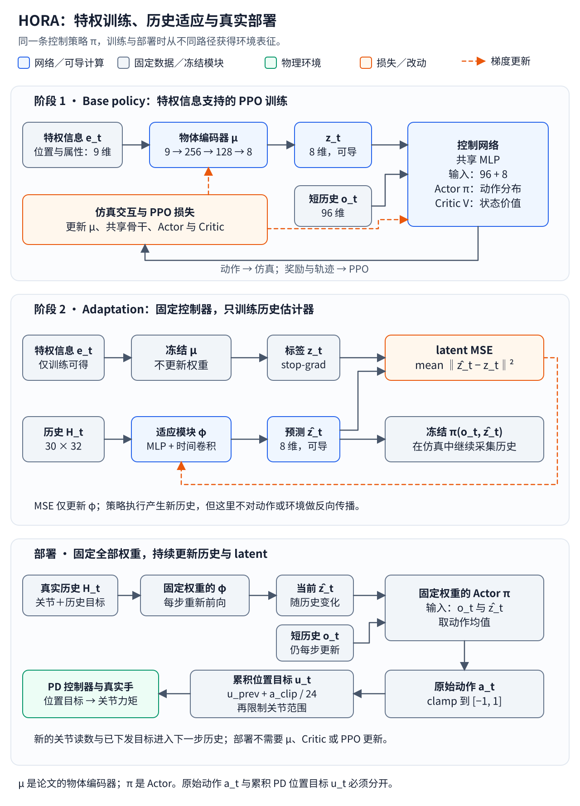
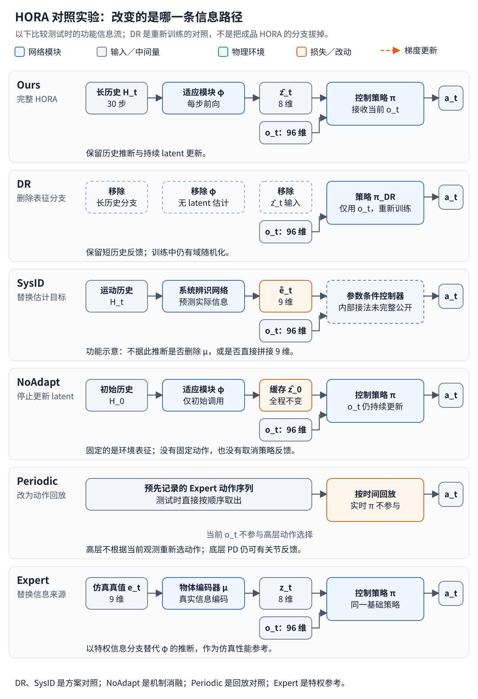

# HORA 精讲：从特权 PPO 策略到本体感知在线适应

> 阅读位置：[灵巧手 RL 研究地图](43_dexterous_rl_overview.md) → [RL 基础：网络、回报与 PPO](44_rl_basics_and_training_loop.md) → [Teacher–Student 与部署](45_teacher_student_and_sim_to_real.md) → 本文。通识章节解释 Actor、Critic、GAE 和 PPO 如何工作；这里将这些概念落实到一篇论文的输入、网络、训练阶段与证据上。

> 论文：Haozhi Qi 等，*In-Hand Object Rotation via Rapid Motor Adaptation*，CoRL 2022。本文结合[论文](https://arxiv.org/abs/2210.04887)、[项目页](https://haozhi.io/hora/)与[官方代码 v0.0.1](https://github.com/HaozhiQi/hora/tree/v0.0.1)，于 2026-10-28 核对。下面明确区分论文的概念描述和公开实现细节；固定版本有助于定位代码，不代表所有实验数值都能逐项复现。

## 1. 从任务确定研究路线

HORA 研究的是：物体已经被四指 Allegro Hand 稳定抓住后，利用指尖持续绕指定轴向旋转，并在物体尺寸、质量、形状等变化时保持操作。主体任务是手内持续旋转，不包含从桌面发现、接近并抓起物体的完整流程，也不能直接等同于任意目标姿态的通用重定向。

它属于以下组合路线：

| 层次 | HORA 的具体选择 |
| --- | --- |
| 任务 | 从初始稳定抓握开始的手内旋转 |
| 行为学习信号 | 旋转进展与稳定性相关的任务奖励 |
| 第一阶段算法 | PPO，通过仿真交互学习特权策略 |
| 策略结构 | 物体信息 MLP、共享控制 MLP、Actor／Critic 输出头 |
| 第二阶段目标 | 从运动历史预测控制所需的环境 latent |
| 部署信息 | 关节位置和历史控制指令；不依赖视觉或触觉传感器输入 |
| 泛化机制 | 训练时域随机化，加上执行时持续更新 latent |

训练不需要一条人类专家动作轨迹。奖励规定旋转和稳定操作的目标，策略自己寻找换指动作。第二阶段虽然有监督标签，但标签是第一阶段生成的 latent，不是逐帧专家动作。

HORA 继承了腿足机器人 [RMA](https://arxiv.org/abs/2107.04034) 的快速适应思路：先学习由特权信息条件化的控制器，再通过历史估计这些信息的控制表征。论文的价值在于将这条路线落实到接触频繁变化的手内操作，并通过奖励、训练物体、初始抓握及真实部署展示其可行性。[项目介绍](https://haozhi.io/hora/)

## 2. 符号、信息来源与维度

同一个“动作”在论文叙述和控制代码中可能指不同层级。本文用 \(a_t\) 表示策略的原始动作输出，用 \(u_t\) 表示发送给底层控制器的关节位置目标，避免把增量动作与累积目标混在一起。

| 符号 | 本文含义 | 维度或类型 | 来源与用途 |
| --- | --- | --- | --- |
| \(t\) | 当前控制时刻 | 整数索引 | 区分当前输入、历史与输出 |
| \(q_t\) | 16 个关节的位置 | 16 维 | 机器人本体感知；实现对关节读数做归一化 |
| \(u_{t-1}\) | 上一次发出的关节位置目标 | 16 维 | 控制命令记录 |
| \(o_t\) | 最近 3 步关节位置与控制指令组成的短历史 | 96 维 | 每步 \(16+16\) 维，供控制策略使用 |
| \(H_t\) | 最近 30 步的同类信息 | \(30\times32\) | 供历史适应模块使用 |
| \(e_t\) | 仿真提供的物体特权信息 | 9 维 | 位置 3、尺寸缩放 1、质量 1、摩擦 1、质心偏移 3 |
| \(\mu\) | 物体信息编码器 | MLP | 将 \(e_t\) 转成环境表征 |
| \(z_t\) | 特权信息编码后的 latent，论文称 extrinsics | 8 维 | 第一阶段控制条件、第二阶段监督目标 |
| \(\phi\) | 历史适应模块 | MLP + 时间卷积 | 从 \(H_t\) 推断环境表征 |
| \(\hat z_t\) | 由历史估计的 latent | 8 维 | 第二阶段执行和真机部署时使用；帽子表示估计值 |
| \(\pi\) | 控制策略／Actor | 条件动作分布 | 根据 \(o_t\) 和 latent 选择动作 |
| \(m_t\)、\(\sigma\) | 高斯动作分布的均值与标准差 | 各 16 维 | 前者依赖输入；该版本的后者是独立可学习参数 |
| \(a_t\) | 原始策略动作 | 16 维 | 训练时采样，推理时通常取均值 |
| \(V\) | Critic 的状态价值预测 | 一个标量 | 第一阶段估计回报，辅助 PPO 更新 |

论文使用 \(o_t=(q_{t-2:t},a_{t-3:t-1})\) 表达短历史。阅读实现时，`compute_observations()` 和部署代码保存的是关节读数与 `cur_targets`／历史位置目标。本文的 \(u\) 特意将这类目标与原始高斯采样动作 \(a\) 分开。[观测与控制实现](https://github.com/HaozhiQi/hora/blob/v0.0.1/hora/tasks/allegro_hand_hora.py)、[部署实现](https://github.com/HaozhiQi/hora/blob/v0.0.1/hora/algo/deploy/deploy.py)

\(e_t\) 也不全是固定物理常数：物体位置会随时间变化。\(z_t\) 的每一维没有预先指定必须代表质量或摩擦；它由控制任务的训练目标塑造。预测 \(z_t\) 成功，不意味着恢复了每个物理参数的精确值。

## 3. 三个阶段对应三条不同的信息流

[打开三阶段矢量图](../assets/figures/hora-training-deployment.svg)。

图中的三行应分开阅读。第一阶段先学会控制；第二阶段学习如何从可获得的历史构造控制条件；第三阶段只运行部署所需的前向计算。

| 阶段 | 控制策略使用的 latent | 主要更新参数 | 监督来源 |
| --- | --- | --- | --- |
| 特权策略学习 | \(z_t=\mu(e_t)\) | 编码器、共享骨干、Actor、Critic 和动作分布参数 | 环境奖励，经 GAE／PPO 构造训练目标 |
| 历史适应学习 | \(\hat z_t=\phi(H_t)\) | 仅 \(\phi\) | 固定编码器给出的 \(z_t\) |
| 真机部署 | \(\hat z_t=\phi(H_t)\) | 不更新网络权重 | 无训练 loss；历史与 latent 随执行更新 |

这里可以用 teacher–student 视角理解信息迁移，但不能把图机械地画成“一个大 Actor 蒸馏出另一个小 Actor”。HORA 保留底层控制策略，重点替换产生环境条件的分支。

## 4. 第一阶段：PPO 同时塑造环境表示与控制策略

### 4.1 物体信息编码器并不处理图像

\[
z_t=\mu(e_t),\qquad
\mu:\mathbb R^9\rightarrow\mathbb R^8.
\]

\(\mathbb R^d\) 表示 \(d\) 维实数向量空间。编码器的线性层尺寸为：

~~~text
e_t：9 → 256 → 128 → 8：z_t
~~~

它处理的是仿真已经给出的数值，省去了从图像或接触信号估计物体状态的困难。这里的 encoder 是模块职责，不限定某一种大模型架构。

### 4.2 Actor 和 Critic 共享 MLP 骨干

\[
x_t=[o_t;z_t]\in\mathbb R^{104},\qquad
h_t=f(x_t)\in\mathbb R^{128}.
\]

\([\,;\,]\) 表示向量拼接，\(x_t\) 是拼接后的策略输入，\(f\) 是共享 MLP，\(h_t\) 是它输出的中间特征。这里的 \(h_t\) 不是完整运动历史；运动历史使用 \(H_t\) 表示。

这里的 \(x_t\) 专指共享 MLP 的输入。完整训练网络仍接收原始 \(o_t,e_t\)，在 PPO 更新时重新经过 \(\mu\) 计算 \(z_t\)，才能让梯度传回物体编码器；不要把缓存的、已断开计算图的 latent 当成完整训练接口。

~~~text
o_t：96 + z_t：8
        ↓ 拼接
共享 MLP：104 → 512 → 256 → 128
        ├─ Actor 均值头：128 → 16
        └─ Critic 价值头：128 → 1
~~~

Actor 的随机动作接口为：

\[
a_t\sim\pi(\cdot\mid o_t,z_t)
=\mathcal N\!\left(m_t,\operatorname{diag}(\sigma^2)\right).
\]

\(\mathcal N\) 表示高斯分布，\(\operatorname{diag}(\sigma^2)\) 表示各动作维度条件独立的对角协方差。Actor 头预测均值 \(m_t\)，标准差由可学习的 log-standard-deviation 参数取指数获得。Critic 预测一个状态价值；它没有为每一个候选动作单独输出 \(Q\) 值。

下文用 \(m_\pi(o_t,z_t)\) 表示策略分布的均值函数，区分“分布 \(\pi\)”与“选定的动作数值”。训练时可以从分布采样，本文的部署和 NoAdapt 确定性表达式使用这个均值。

公开代码的共享 MLP 使用 ELU；编码器输出和适应模块输出还经过 `tanh`。论文附录对编码器激活函数的描述与这份实现有差异，复现网络应直接核对所用版本。[模型实现](https://github.com/HaozhiQi/hora/blob/v0.0.1/hora/algo/models/models.py)、[训练配置](https://github.com/HaozhiQi/hora/blob/v0.0.1/configs/train/AllegroHandHora.yaml)

### 4.3 PPO 在网络之外组织采样和更新

第一阶段的控制器最初并不会旋转物体，Critic 也不预先知道未来回报。仿真交互产生奖励和状态变化，PPO 将这些经历转成 Actor 与 Critic 的训练目标。反向传播经过共享骨干，因此 \(\mu\) 也能学到哪些物体信息有助于控制。

此时的 Expert 是第一阶段最终得到的特权策略。“Expert”表示它在后续比较中的角色，不表示训练时必须存在人类专家动作。

关于 old log-probability、GAE、固定 return target 和两种 loss 的逐项含义，见 [RL02 的 Actor–Critic 与 PPO 训练链路](44_rl_basics_and_training_loop.md)。HORA 在此使用已有算法，其方法重点没有落在修改 PPO 目标函数上。

### 4.4 Reward 与初始抓握共同决定可学性

为避免把论文中的代价符号与实现权重混淆，下面按 `v0.0.1` 的计算方式组织奖励。设 \(\omega_t\) 为物体角速度，\(k\) 为目标旋转方向的单位向量，\(v_t\) 为物体线速度，\(q_{\mathrm{init}}\) 为本次初始关节姿态，\(\tau_t\) 为命令力矩，\(\dot q_t\) 为关节速度：

\[
r_t=\operatorname{clip}(\omega_t^\top k,-0.5,0.5)
-\alpha_v\|v_t\|_1
-\alpha_q\|q_t-q_{\mathrm{init}}\|_2^2
-\alpha_\tau\|\tau_t\|_2^2
-\alpha_w(\tau_t^\top\dot q_t)^2.
\]

其中 `clip` 将数值限制在给定区间；\(\|\cdot\|_1\) 是绝对值之和，\(\|\cdot\|_2^2\) 是平方和。\(\alpha_v,\alpha_q,\alpha_\tau,\alpha_w\) 是非负权重，此配置分别为 0.3、0.3、0.1、2.0。该版本的 `compute_reward()` 将旋转方向设为 \(k=(0,0,-1)\)，复现时需同时检查坐标约定。最后一项是该代码实现的功率相关惩罚，不应直接当成实际机械能的累计测量。

| 奖励部分 | 对学习行为的约束 |
| --- | --- |
| 指定方向角速度 | 鼓励持续旋转；裁剪减少单纯追求更高速度的收益 |
| 物体线速度代价 | 减少物体在手中不稳定移动 |
| 偏离初始手姿代价 | 为动作提供姿态约束 |
| 力矩及功率相关代价 | 抑制过于激烈、耗力的控制 |

论文公式与公开代码在范数、功率项等细节上并非完全相同。因此应分别引用概念公式和实际执行的 reward，不能把论文附录的符号不加检查地抄进程序。[奖励实现](https://github.com/HaozhiQi/hora/blob/v0.0.1/hora/tasks/allegro_hand_hora.py)、[权重配置](https://github.com/HaozhiQi/hora/blob/v0.0.1/configs/task/AllegroHandHora.yaml)

上述 \(r_t\) 是环境返回的原始奖励。PPO 采样实现还会缩放奖励、处理超时 bootstrap，并对价值做归一化；日志中的分数、训练缓冲区里的目标和论文评估指标需要按各自代码路径核对。

训练从稳定抓握初始化，并随机化物体与动力学。这样的 reset 让策略把交互预算用于持续旋转，而不必同时解决从桌面抓取。Reward、reset、物体分布和并行仿真一起构成训练方案；单看网络层数无法解释技能如何获得。

## 5. 第二阶段：用历史估计控制所需的 latent

### 5.1 历史为何能提供信息

同样的位置目标发给手指，不同质量、接触和几何条件会产生不同的关节运动。历史模块接收“曾经发出什么指令”和“实际测到了什么运动”，由这些时序关系估计当前操作条件。

输入不是一幅完整物体模型，也不是触觉图像。它只提供与当前控制交互有关的证据；不同物理环境可能产生相近历史，因此不能保证所有物体参数都被唯一辨识。

### 5.2 历史编码器的张量变化

对一个样本忽略 batch 维度，\(\phi\) 的结构是：

| 步骤 | 运算 | 输出形状 |
| --- | --- | --- |
| 输入 | 30 步，每步 16 个关节读数和 16 个位置目标 | \(30\times32\) |
| 逐时间步编码 | 同一个 MLP，32 → 32 → 32 | \(30\times32\) |
| 时间卷积 1 | 通道 32 → 32，核 9，步长 2，无 padding | \(32\times11\) |
| 时间卷积 2 | 通道 32 → 32，核 5，步长 1 | \(32\times7\) |
| 时间卷积 3 | 通道 32 → 32，核 5，步长 1 | \(32\times3\) |
| 展平与投影 | 96 → 8，随后 `tanh` | \(\hat z_t\in\mathbb R^8\) |

卷积阶段的形状顺序为“通道 × 时间长度”。在 20 Hz 控制频率下，30 步覆盖约 1.5 秒。代码中残留的 50 帧注释不应覆盖实际配置和投影尺寸。[历史网络](https://github.com/HaozhiQi/hora/blob/v0.0.1/hora/algo/models/models.py)、[历史长度配置](https://github.com/HaozhiQi/hora/blob/v0.0.1/configs/task/AllegroHandHora.yaml)

### 5.3 固定控制器，改变标签来源与梯度路径

\[
z_t=\operatorname{stopgrad}(\mu(e_t)),\qquad
\hat z_t=\phi(H_t),\qquad
\mathcal L_{\mathrm{adapt}}
=\mathbb E\left[\|\hat z_t-z_t\|_2^2\right].
\]

`stopgrad` 表示把目标视作常量，不通过它更新标签网络；\(\mathbb E\) 表示对训练样本取平均。这个阶段冻结 \(\mu\)、共享控制骨干与输出头，只更新 \(\phi\)。

数据采集也需要区分：执行策略使用的是 \(\pi(o_t,\hat z_t)\)，因此历史来自“估计 latent 的控制器”实际访问的状态。与此同时，仿真仍提供 \(e_t\)，冻结的 \(\mu\) 可以为同一状态产生监督目标。它不是只在完美 Expert 的成功轨迹上离线拟合一次。

这可以称为 **on-policy latent supervision**：on-policy 指采样来自当前适应策略，latent supervision 指梯度来自潜变量误差。核对下文链接的 v0.0.1 实现，它没有采用原始 DAgger 的跨轮数据集聚合循环，因此不宜直接称作“用 latent loss 的标准 DAgger”。监督目标与数据采集是两条轴，通用区别见 [RL03 的 BC、DAgger 与 latent 监督](45_teacher_student_and_sim_to_real.md)。

~~~python
# 概念化第二阶段；省略归一化与并行环境接口
for parameter in encoder_and_control_parameters:
    parameter.requires_grad = False

z_target = encoder(privileged_info).detach()
z_pred = adaptation(history)
loss = ((z_pred - z_target) ** 2).mean()

optimizer_phi.zero_grad()
loss.backward()
optimizer_phi.step()

# 与环境交互仍使用估计的 latent，而不是 z_target
action = policy_mean(short_history, z_pred.detach())
next_observation = env.step(action)
~~~

这段代码强调监督与执行使用什么信息，并非官方训练循环的逐行复制。实际实现还处理动作限幅、观测统计和交互时序。环境奖励可以用于记录表现，但适应模块的梯度来自 latent MSE。[第二阶段训练代码](https://github.com/HaozhiQi/hora/blob/v0.0.1/hora/algo/padapt/padapt.py)

## 6. 部署：固定参数下的闭环适应

部署链路为：

\[
H_t\xrightarrow{\phi}\hat z_t,\qquad
(o_t,\hat z_t)\xrightarrow{\pi}a_t.
\]

历史每步更新，\(\hat z_t\) 也随之更新。网络权重保持固定，没有在真机上继续运行 PPO。Critic 与特权编码器不承担部署决策；即便软件对象保留相关层，也不意味着策略必须读取它们的输出。

代码里的原始动作还要变成底层控制目标：

\[
u_t=\operatorname{clip}_{\mathrm{joint}}\!
\left(u_{t-1}+\frac{1}{24}\operatorname{clip}(a_t,-1,1)\right).
\]

\(u_t\) 是新的关节位置目标；\(\operatorname{clip}_{\mathrm{joint}}\) 表示按每个关节的上下限限幅。策略输出的是目标增量的归一化控制量，不能直接当成绝对关节角或力矩。

PD 控制器再根据目标与实际关节状态形成力矩，概念上为：

\[
\tau_t=K_p(u_t-q_t)-K_d\dot q_t.
\]

\(K_p\) 是比例增益，\(K_d\) 是阻尼增益。策略读取关节历史的闭环与底层 PD 的关节反馈是两个层级；回放高层动作时，底层 PD 也可以继续存在。[部署代码](https://github.com/HaozhiQi/hora/blob/v0.0.1/hora/algo/deploy/deploy.py)

## 7. 对照实验：删除、替换、停止更新与性能参照

[打开对照实验矢量图](../assets/figures/hora-baseline-comparison.svg)。

图中六行主要比较测试时的信息流。训练过程必须另外说明：例如 DR 要按自身输入重新训练，不能从训练好的 HORA 中直接拔掉 latent 分支就当作公平对照。

| 方法 | 测试时的结构 | 相对 HORA 的改动 | 检验的设计问题 |
| --- | --- | --- | --- |
| HORA／Ours | \(H_t\to\phi\to\hat z_t\)，再与 \(o_t\) 一起进入 \(\pi\) | 完整方案 | 历史条件控制是否有效 |
| DR | \(o_t\to\pi_{\mathrm{DR}}\) | 去掉环境表征分支，使用域随机化重新训练 | 直接训练鲁棒策略是否足够 |
| SysID | 历史 → 显式信息估计 \(\hat e_t\) → 参数条件控制 | 预测目标由 latent 换为物理信息 | 必须精确估计参数，还是学习控制表征更合适 |
| NoAdapt | 只在开始时计算 \(\hat z_0\)，随后 \(a_t=m_\pi(o_t,\hat z_0)\) | 固定 latent，保留实时观测与策略 | 初始估计是否足够 |
| Periodic | 预先记录 Expert 动作，再按时间回放 | 实时策略决策由动作序列替代 | 固定动作模式能否应对不同条件 |
| Expert | \(e_t\to\mu\to z_t\)，再与 \(o_t\) 一起进入 \(\pi\) | 直接使用特权信息 | 不必推断 latent 时的性能参照 |

其中 \(\pi_{\mathrm{DR}}\) 是独立训练的 DR 策略，\(\hat e_t\) 是显式参数估计，\(\hat z_0\) 是初始 latent。Expert 来自本方法的第一阶段，不是人类示范者，也不是数学上保证最优的控制器。[对照定义](https://arxiv.org/html/2210.04887v1#S4)

### 7.1 DR 是方法路线，NoAdapt 是机制消融

DR 代表域随机化直接训练策略的思路。OpenAI 的 [Dactyl](https://arxiv.org/abs/1808.00177) 和[魔方操作](https://arxiv.org/abs/1910.07113) 是相关路线的代表；HORA 的 DR 行不是这些整套系统在相同硬件上的逐层复现。

HORA 自己也使用域随机化。对比关注的是“仅依靠随机化与直接策略学习”和“再加入显式 latent 适应”。DR 仍根据关节观测更新动作，不能理解为开环或固定动作回放。

SysID 是另一种环境估计设计；NoAdapt 是对自身机制的直接消融；Periodic 是行为解释的对照；Expert 是特权性能参照。这些名字没有构成所有灵巧手 RL 论文的必做清单。通用实验设计原则见 [RL02](44_rl_basics_and_training_loop.md)。

### 7.2 SysID 的已知边界

论文明确给出的是预测目标从 \(z_t\) 改成 \(e_t\)。公开资料没有完整展示 \(\hat e_t\) 到控制器之间的逐层连接，不能据此断言它一定删除 \(\mu\)、一定直接拼接成 105 维输入，或者估计器与 \(\phi\) 的每一层完全相同。因此图中参数条件控制器保留为功能模块。

### 7.3 NoAdapt 固定的是 latent

NoAdapt 每步仍读取新的 \(o_t\)，并重新计算动作。它去掉的是对环境条件的持续重估，不是冻结动作序列。完整 HORA 的“在线更新”则指输入、历史和 latent 更新，不能与网络权重更新混为一谈。

## 8. 实验协议：分布变化与仿真迁移是两条轴

### 8.1 Table 1 的两栏都在仿真中

Within Training Distribution 使用与训练相同的物体集合和随机化规则重新评估策略；Out-of-Distribution 扩大参数范围并加入新形状。前者是分布内测试，不是训练 loss 或训练 reward 曲线；后者也不等于真机。[论文 §5.1](https://arxiv.org/html/2210.04887v1#S5.SS1)

| 设置举例 | 训练／分布内测试 | 分布外测试 |
| --- | --- | --- |
| 形状 | 圆柱体集合 | 圆柱体，并加入各 10% 的球体和立方体 |
| 质量 | 0.01–0.25 kg | 0.01–0.30 kg |
| 摩擦系数 | 0.3–3.0 | 0.2–3.5 |
| 缩放系数 | 0.70–0.86 | 0.66–0.90 |

分布外范围与训练范围存在重叠，因此不能说每一个 OOD 样本的每一个参数都在训练范围之外。改变的是整体任务生成分布。相关范围见论文附录 Table 5。

### 8.2 Figure 3、4 是真机对照

两组分别测试较重物体与不规则物体，每组 6 个物体，采用 20 种初始抓握位置，每次最多 30 秒。Expert 因无法直接读取所需真值而未加入真机对照；Periodic 在仿真中表现较差，也未继续列入这一组实机比较。[真机评估设置](https://arxiv.org/html/2210.04887v1#S5.SS1)

因而应分别记录：实验在什么设备上运行，以及测试物体和参数是否超出训练分布。只有仿真 OOD 成绩，不能自动推出真机迁移效果。

### 8.3 指标与单位

| 指标 | 含义 | 阅读时的边界 |
| --- | --- | --- |
| RotR | 仿真旋转奖励指标 | 不直接当成旋转圈数；也不能与实机 Rotations 数值横比 |
| TTF | 掉落前持续时间，按最大时长归一化 | 不是成功率；仿真最大 20 秒，实机最大 30 秒 |
| Rotations | 实机一次运行中的净旋转角度 | 单位是弧度，\(2\pi\) 弧度才是一整圈 |
| ObjVel | 仿真物体线速度大小，表中做了缩放 | 主要反映稳定性 |
| Torque | 命令力矩绝对值之和的时间平均 | 是控制强度的代理量，不等同于测得的总能耗 |

例如 \(\mathrm{TTF}=0.8\) 表示平均持续到最大时长的 80%，不能读成“80% 的任务成功”。这些量衡量不同侧面：更快旋转、持续更久和更小力矩不必同时改善。[指标定义](https://arxiv.org/html/2210.04887v1#S4)

### 8.4 主要结果支持哪条设计

下表只摘取论文 Table 1 与 Figure 3、4 的均值，用来连接方法与结果；完整标准差、稳定性和力矩指标应结合原表阅读。仿真列是 RotR，真机列是净旋转弧度，不同列不能直接比较数值大小。

| 方法 | 仿真 ID：RotR | 仿真 OOD：RotR | 真机重物：弧度 | 真机不规则物体：弧度 |
| --- | --- | --- | --- | --- |
| DR | 176.12 | 140.80 | 9.67 | 6.59 |
| SysID | 174.42 | 132.56 | 10.36 | 8.16 |
| HORA | 222.27 | 160.60 | 23.96 | 19.22 |
| Expert | 233.71 | 165.07 | 未评测 | 未评测 |

在这组协议下，HORA 的仿真旋转指标接近有特权信息的 Expert，真机累计旋转量也高于 DR 与 SysID。重物组中 HORA 的平均 TTF 为 0.98，说明其较大转角同时伴随较长的保持时间。这些是指定任务、物体和评估条件下的证据，不能单独推出任意手型、任意姿态目标的泛化能力。[论文主实验](https://arxiv.org/html/2210.04887v1#S5.SS1)

### 8.5 附录实验检验训练与历史设计

附录还比较了去掉物理随机化、改变适应模块历史长度，以及让 DR 直接接收更长历史。DR-MLP 将历史展平后输入策略，DR-LSTM 先通过循环网络处理时间信息。[附录 B](https://arxiv.org/html/2210.04887v1#A2)

这组实验帮助区分“额外历史信息”与“用 latent 监督组织历史学习”的作用。作者报告在自己的 PPO 设置中，直接优化长历史策略较困难。由此可支持该训练设计的选择，但不能推导成 LSTM 普遍不适合灵巧操作，或历史越长一定越差。计算预算、优化设置与任务分布都是结论的适用条件。

## 9. 从结果定位贡献与局限

HORA 的核心连接是：**先用特权信息训练可控制的表示，再让本体感知历史提供这种表示，从而保留底层控制技能并改变部署信息来源。** 这使一篇看似主要使用 MLP 和 PPO 的论文，仍然可以在任务设计、适应接口与真实泛化上形成贡献。

阅读其证据时，可以采用以下对应关系：

| 设计主张 | 对应证据 | 不应额外推导的结论 |
| --- | --- | --- |
| 历史中的交互信息能支持适应 | 与 DR、SysID 的控制效果比较，latent 随物体变化的分析 | latent 每一维都等价于某个真实物理参数 |
| 持续重估环境条件有用 | 与 NoAdapt 比较 | 所有部署都需要在线更新权重 |
| 手指动作具有反馈适应性 | 与 Periodic 比较 | 任何预先设计控制器都不能工作 |
| 仿真学到的技能可迁移 | 真机物体和扰动展示、重复试验 | 已获得从感知、抓取到任意操作的完整通用系统 |

技能范围仍受初始抓握、手型、控制接口和训练任务影响。只靠本体感知也存在信息边界：相似历史可能对应不同接触条件，未知物体的尖角、孔洞、柔性和较大偏心可能导致失败。历史推断性能必须通过闭环控制检验，而不是只看 latent MSE。

如果将来引入视觉或触觉，更有针对性的研究问题是这些信息补足了哪一类隐藏状态、是否改善了失败恢复，以及训练和部署能否获得一致的信息。直接增加模态或换更大的网络，并不能单独证明控制贡献。

## 10. 从论文图走到源码

按数据流读代码，比按文件名逐个浏览更容易保持上下文：

| 阅读顺序 | 文件与入口 | 需要对上的概念 |
| --- | --- | --- |
| 1 | [任务环境](https://github.com/HaozhiQi/hora/blob/v0.0.1/hora/tasks/allegro_hand_hora.py)：`compute_observations`、`compute_reward` | \(o,H,e\) 如何形成，reward、reset、动作目标如何实现 |
| 2 | [网络](https://github.com/HaozhiQi/hora/blob/v0.0.1/hora/algo/models/models.py)：`ActorCritic`、`ProprioAdaptTConv` | \(\mu,\phi,\pi,V\) 各自的数据和参数 |
| 3 | [PPO](https://github.com/HaozhiQi/hora/blob/v0.0.1/hora/algo/ppo/ppo.py)：`play_steps`、`train_epoch` | 先采样，再重新前向并更新；old log-probability 固定 |
| 4 | [经验缓冲区](https://github.com/HaozhiQi/hora/blob/v0.0.1/hora/algo/ppo/experience.py)：`computer_return` | GAE、return target、advantage 标准化 |
| 5 | [历史适应训练](https://github.com/HaozhiQi/hora/blob/v0.0.1/hora/algo/padapt/padapt.py)：`train` | 只更新 \(\phi\)，标签停止梯度，执行用预测 latent |
| 6 | [真机部署](https://github.com/HaozhiQi/hora/blob/v0.0.1/hora/algo/deploy/deploy.py) | 动作增量、关节顺序、历史缓冲区、20 Hz 控制 |

实现中 `self.mu` 是 Actor 的均值输出层，而论文符号 \(\mu\) 指物体信息编码器；后者在代码中叫 `env_mlp`。这两处名字相同但角色不同，读代码时应按张量来源判断。

另外，`v0.0.1` 的 README 本身也提示 reset 顺序等实现差异会影响奖励数值。复现实验需要同时固定版本、手模型、奖励定义、重置与评估协议，而不只固定一个 checkpoint。[官方实现说明](https://github.com/HaozhiQi/hora/blob/v0.0.1/README.md)

## 11. 后续阅读的两个方向

沿学习算法方向，可以从 [RL02](44_rl_basics_and_training_loop.md) 的 PPO 目标、GAE 和固定训练目标继续研究估计误差与训练稳定性。沿灵巧操作方向，可以以 HORA 的历史适应为起点，对照 [研究地图](43_dexterous_rl_overview.md) 中的触觉旋转、点云策略和目标条件操作，逐项记录新增信息如何改变可观察性、技能范围与真机反馈。

这两条方向共享网络与训练的基础，但论文贡献可以落在不同位置：改进 PPO 是算法研究，改善隐藏接触信息的使用方式则是表示、控制与部署研究。
