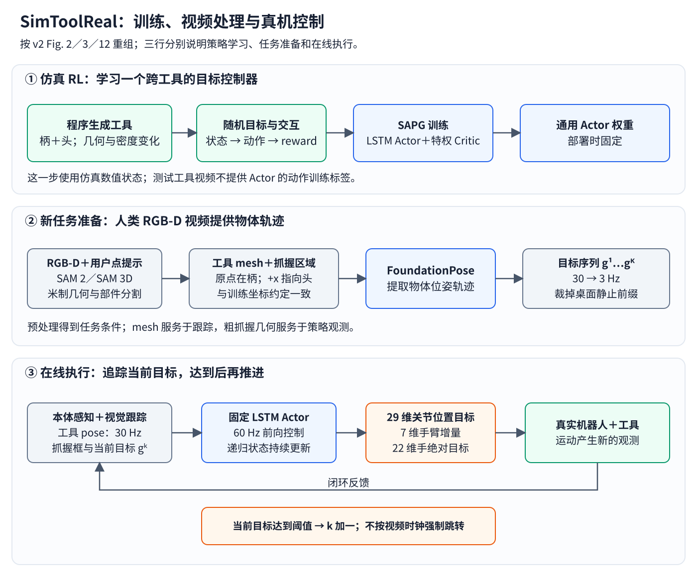
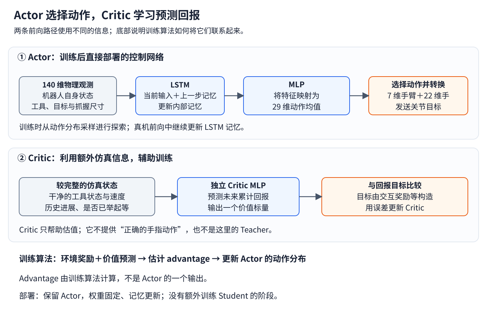

# SimToolReal 精读：先学会控制工具，再用视频指定任务

> 阅读前提：看过 [HORA](46_hora_paper_walkthrough.md) 和 [UniDexGrasp](47_unidexgrasp_paper_walkthrough.md)，知道 Actor 根据观测选择动作即可。本文按“任务 → 训练与部署 → 网络 → 观测 → 感知 → 泛化 → 实验”展开。

> 论文：Kushal Kedia、Tyler Ga Wei Lum、Jeannette Bohg、C. Karen Liu，*SimToolReal: An Object-Centric Policy for Zero-Shot Dexterous Tool Manipulation*。以用户提供的 [arXiv v2（2026-02-24）](https://arxiv.org/abs/2602.16863v2) 为准；[PDF](https://arxiv.org/pdf/2602.16863v2)、[官方项目页](https://simtoolreal.github.io/)。整理更新：2026-11-01。图表编号和实验数字均对应 v2；代码参考另行固定版本。

遇到基础概念时，按需跳转，不必先读完所有前置文章：

| 当前疑问 | 前置知识入口 |
| --- | --- |
| Actor、Critic、advantage 各由谁计算？MLP 和 LSTM 有什么区别？ | [RL02：RL 训练闭环](44_rl_basics_and_training_loop.md)，第 0、3 节 |
| Actor–Critic 和 Teacher–Student 为什么不是同一层概念？ | [RL03：训练角色与部署](45_teacher_student_and_sim_to_real.md)，第 0、4 节 |
| 6D 位姿、四元数、mesh、相机标定和 FoundationPose 是什么？ | [F05：视觉状态估计](50_visual_state_estimation_and_foundationpose.md) |

## 1. 先理解它要学会什么

**SimToolReal 先在仿真中训练一个“把工具移动到目标位姿”的通用策略，再把人类视频变成一串目标，让同一个策略依次执行。**

以锤子为例，人类示范可以变成“举起来 → 调整朝向 → 移到钉子上方 → 向下运动”。这里记录的是**锤子如何运动**，没有规定机器人必须照抄人类手指的关节角。机器人需要自己决定怎样抓、怎样换指、手臂怎样配合。

因此，先把整套系统理解为两个职责：

~~~text
任务描述：这把工具接下来应该到哪里、朝向哪里？
                         ↓ 当前目标位姿
RL 控制：结合工具和机器人的当前状态，决定手臂与手指怎样动。
~~~

“位姿”就是位置加朝向。只要求位置不够：锤柄朝上和锤头朝上，即使工具中心在同一处，也是不同的操作状态。

这个抽象也限定了论文的能力边界：**完成工具的运动轨迹，不自动等于完成工具的物理功能。** 螺丝刀在空中转动与把螺丝拧紧，需要不同层次的证据。

## 2. 人类视频用在哪里？把三个环节分开

[放大流程图](../assets/figures/simtoolreal-pipeline.svg)。对应论文 Fig. 2、3 和附录 E。

### 2.1 先训练：程序生成的工具＋随机目标

仿真里放入大量不同尺寸、形状和物理属性的工具状物体，随机指定目标位姿。Actor 尝试动作，环境返回奖励，再用 RL 更新网络。达到一个目标后继续采样下一个目标，让策略学习连续控制。

**这套通用策略的训练不依赖测试任务的人类视频，也没有先用这些视频训练一个 Teacher。** 仿真直接提供构造观测所需的数值状态，再加入噪声和延迟；不用每步渲染图像后调用 FoundationPose。

### 2.2 再准备任务：从新工具的视频得到几何和轨迹

给定新工具的一段 RGB-D 人类示范，处理出两类结果：工具的三维模型与抓握区域，以及工具的目标位姿序列。RGB-D 指彩色图像和对应深度图，区别于只有颜色的普通视频。

视频主要告诉系统“工具应该怎么运动”。它没有变成机器人动作标签，也没有用于对这套策略进行该任务的专属微调。具体处理算法见第 5 节。

### 2.3 最后部署：同一个 Actor 根据实时反馈执行

机器人读取关节状态，相机估计工具当前位姿，程序取出当前目标。Actor 根据这些信息输出动作；接近目标后，再推进到下一个目标。

| 环节 | 学习或执行的内容 | 是否更新 RL 网络权重 |
| --- | --- | --- |
| 仿真训练 | 学会抓取、重定向和到达随机目标 | 更新 Actor 和 Critic |
| 视频预处理 | 建立新工具几何，提取目标序列 | 不更新 |
| 真机控制 | 跟随准备好的目标，持续响应当前状态 | 不更新；更新 LSTM 记忆和目标索引 |

这里“零样本”指新测试工具、新轨迹无需专门训练或微调策略。物体建模、用户分割提示和坐标标定仍然需要完成。

## 3. RL 网络：有 Actor–Critic，没有额外蒸馏 Student

### 3.1 先分清两个层级

**Actor–Critic 说明一次 RL 训练中谁负责动作、谁负责估值；Teacher–Student 说明模型之间怎样传递知识。二者可以同时存在。** 例如 UniDexGrasp 可以先用 Actor–Critic 训练 Teacher，再由 Teacher 教 Student。

SimToolReal 采用非对称 Actor–Critic：Actor 只用部署时能够获得的信息，Critic 在训练中额外读取仿真状态。训练完成后直接部署这个 Actor，没有再蒸馏一个 Student。

### 3.2 Actor 为什么是 LSTM＋MLP？

Actor 的前向过程是：

~~~text
当前数值观测 + 上一步记忆
          ↓
       LSTM：结合过去与现在，更新记忆
          ↓
        MLP：把特征映射成动作分布参数
          ↓
       29 维动作：7 维手臂 + 22 维灵巧手
~~~

可以想象机器人连续几步发出“握紧”的命令，但工具仍在滑动。单步观测只呈现当前结果；带记忆的策略还可以结合之前的动作与运动变化。论文希望借此隐式适应不直接观测的工具属性，以及观测噪声、延迟。它不要求 LSTM 显式输出一个准确的质量或摩擦系数。

Table I 给出的配置是：LSTM 隐藏维度 1024，后接宽度为 `[1024, 1024, 512, 512]` 的 MLP。HORA 的控制 Actor 使用 MLP，并另有历史适应模块；这里把记忆放在 Actor 内，通过 RL 一起训练。**部署时记忆变化，不等于网络还在反向更新。**

### 3.3 Critic 怎样帮助它学习？

Critic 是独立 MLP，输出一个预期累计回报。除了较干净的观测，它还能读取物体和手掌的真实速度、历史最好距离、是否已经举起等训练信息。

训练算法用环境奖励和价值估计构造回报目标、advantage：Critic 学着把回报预测得更准，Actor 根据 advantage 调整动作分布。**Advantage 由训练算法计算；Critic 不给出“正确的手指动作”，也不是这里的 Teacher。**

[放大网络图](../assets/figures/simtoolreal-actor-critic.svg)。优化采用已有的 SAPG：沿 PPO 路线组织不同探索策略，并利用它们收集的经验。SAPG、LSTM 和非对称 Critic 都不是本文首次提出的模块。

动作经过转换后才发给机器人：7 维手臂动作表示相对上一次关节目标的增量；22 维手部动作映射为关节范围内的绝对位置目标。两部分都会平滑、限幅。因此，策略动作与最终关节命令不能直接混为一个数组。

## 4. Actor 到底看什么？拆开 140 维观测

Actor 接收的是一组数值，**不直接读取 RGB、人类视频、语言或点云**。附录 C.3 列出共 140 维物理观测；下表按固定版本代码的 `obsList` 顺序排列，同时列出训练与部署来源。

切片采用 Python 的左闭右开记法，例如 `0:29` 是第 0 至 28 项，共 29 个数。一批并行观测的格式是浮点张量 `[B, 140]`；`B` 是环境数，真机单个机器人通常为 `[1, 140]`。

| 切片／输入字段 | 维度 | 仿真训练来源 | 真机部署来源 |
| --- | --- | --- | --- |
| `0:29` 关节位置 | 29 | 仿真关节角，按关节范围缩放 | 机器人关节读数，同样缩放 |
| `29:58` 关节速度 | 29 | 仿真关节速度 | 机器人状态接口 |
| `58:87` 上一次关节位置目标 | 29 | 程序保存的上次位置命令 | 程序保存的上次位置命令 |
| `87:90` 手掌位置 | 3 | 仿真手掌中心 | 关节状态与正运动学 |
| `90:94` 手掌朝向 | 4 | 仿真四元数 | 正运动学四元数 |
| `94:98` 工具朝向 | 4 | 仿真工具位姿，经过观测扰动 | FoundationPose 位姿估计，经坐标转换 |
| `98:113` 五个指尖相对手掌的位置 | 15 | 仿真指尖位置减手掌中心 | 正运动学计算，无需触觉传感器 |
| `113:125` 四个工具关键点相对手掌的位置 | 12 | 工具位姿与抓握框计算 | 视觉位姿与预处理抓握框计算 |
| `125:137` 四个当前关键点减对应目标点 | 12 | 当前工具状态与随机目标计算 | 当前估计位姿与视频目标计算 |
| `137:140` 抓握区域尺寸 | 3 | 生成工具的柄尺寸，加入尺寸扰动 | 部署前提取的柄长、宽、高 |
| **合计** | **140** | **机器人自身 109 维＋工具与目标 31 维** | **字段、顺序与训练对齐** |

空间位置与尺寸采用米，四元数采用 `(x, y, z, w)`；仿真还对观测施加噪声和延迟。关节顺序、缩放及网络归一化也要保持一致，不能仅保证数组长度相同。上一次位置目标是经过动作转换后的命令，不是原始的 29 维 Actor 输出。[观测配置](https://github.com/tylerlum/simtoolreal/blob/313d5aea1f507c6cfe097b672b62945d7b0bbff5/isaacgymenvs/cfg/task/SimToolReal.yaml)、[部署观测构造](https://github.com/tylerlum/simtoolreal/blob/313d5aea1f507c6cfe097b672b62945d7b0bbff5/isaacgymenvs/utils/observation_action_utils_sharpa.py)。

### 4.1 这四个关键点是怎么来的？

它们是根据抓握区域长宽高，在工具局部坐标中定义的**四个虚拟几何点**。知道工具当前位姿，就能算出它们现在的位置；知道目标位姿，就能算出同样四个点应当在哪里。无需让视觉模型逐点检测。

只比较工具中心的位置，看不出朝向是否正确。四个点同时提供位置和朝向信息：中心虽已到达，工具若仍是横着的，对应点的差就仍然存在。Actor 输入的是四组“当前点减目标点”的三维向量，共 12 维，并没有先压成一个距离分数。

另外 12 维表示四个当前工具点各自减去手掌中心的位置。这里是**在共同坐标系中做位置相减**，不是把坐标轴旋转到手掌坐标系。

### 4.2 抓握区域与工具位姿怎样进入输入？

抓握框描述的是适合抓取的区域，通常是工具柄，而不是整把工具的外包围盒。论文把工具坐标原点放在柄中心，正 x 轴指向工具头，保持训练与部署的约定一致。

工具中心位置已经包含在四个关键点的位置中，因此表里没有再单列一个 3 维工具中心。目标也通过对应点误差进入网络，无需再拼一个完整目标矩阵。四元数用 4 个数表示朝向；这与“旋转有 3 个自由度”并不矛盾，基础解释见 [F05](50_visual_state_estimation_and_foundationpose.md)。

### 4.3 训练和部署的格式一致，是否意味着信息完全一样？

**在这篇方法中，Actor 的物理观测字段和含义保持一致，数值来源不同。** 训练用仿真状态加噪声、延迟来构造输入；部署用传感器、运动学和视觉估计。训练目标随机采样，部署目标来自视频。

| 阶段 | 执行动作的网络与输入 | 额外信息的用途 |
| --- | --- | --- |
| RL 训练 | Actor：`[B, 140]`＋单独保存的 LSTM 记忆 | Critic 读取较完整的仿真状态，辅助估值 |
| 真机部署 | 同一个 Actor：`[1, 140]`＋LSTM 记忆 | 不需要 Critic，也没有另外的 Student 输入 |

这不是“没有 Student”自动保证的，需要代码明确对齐顺序、单位、坐标系和归一化。部署时拿到的是有误差的估计值，不能把它等同于仿真真值。Critic 的额外输入则无需在真机上恢复。

140 维只统计上述物理量；LSTM 记忆单独保存。公开代码还存在 SAPG 策略条件的包装，不能把 140 当成所有内部张量的统一维度。

## 5. 真实世界如何拿到这些看似“特权”的信息？

论文在 **§III-C、附录 E 和 Fig. 12** 中给出了方法。关键是分清：**几何事先准备，当前位姿实时估计，目标从示范序列读取。**

### 5.1 部署前：重建工具，确定哪里可以抓

| 步骤 | 使用的算法或操作 | 得到什么 |
| --- | --- | --- |
| 找到整把工具 | 在 RGB-D 视频第一帧给出用户点提示，运行 SAM 2 | 工具的图像分割 mask |
| 恢复三维外形 | SAM 3D 重建；以相机实测深度替换默认预测深度 | 有真实尺度的三维 mesh |
| 区分工具柄和头 | 从多个虚拟视角渲染 mesh；用户在首视图提示部件，SAM 2 传播分割 | 多视角的柄、头区域 |
| 得到抓握框 | 用已知虚拟相机参数将区域深度反投影成三维点，分离部件 | 柄的中心、朝向和长宽高 |

因此，这是**包含用户提示的半自动流程**。抓握区域也不是 FoundationPose 自动判断出来的；FoundationPose 的职责是估计已经建模的工具在哪里、朝向哪里。

### 5.2 离线处理人类视频：提取目标序列

准备好 mesh 后，FoundationPose 根据 RGB-D 视频逐帧估计工具位姿，得到一条物体运动轨迹。论文将 30 Hz 的原始序列降采样到 3 Hz，并去掉工具尚未举起的静止前缀，保留后续目标。

这里的“分段 goal”更准确地说是**位姿轨迹上的离散目标点**。论文没有先让语义模型把视频识别成“抓取／旋转／敲击”几个动作段，再训练相应技能。

### 5.3 在线执行：估计当前位姿，跟随已经给定的目标

| Actor 需要的信息 | 执行时怎样得到 | 是否每帧重新计算 |
| --- | --- | --- |
| 当前工具位姿 | 实时 RGB-D＋已准备的 mesh → FoundationPose | 持续跟踪 |
| 抓握区域尺寸 | 读取预处理保存的尺寸 | 同一刚性工具通常固定 |
| 当前目标位姿 | 从人类示范目标序列中取第 k 个 | 达到目标后切换 |
| 手掌、指尖状态 | 机器人关节状态＋正运动学 | 随机器人运动更新 |
| 相对位置与目标误差 | 将上述量变换到共同坐标系后计算 | 随观测更新 |

相机坐标与机器人坐标必须经过标定才能比较。相机测到的“前方 30 cm”与机器人坐标中的“前方 30 cm”，可能指不同的位置。这部分通用原理与 FoundationPose 的内部过程放在 [视觉状态估计基础](50_visual_state_estimation_and_foundationpose.md)。

论文报告在线位姿跟踪为 30 Hz、策略控制为 60 Hz。目标序列的 3 Hz 是预处理采样密度，**不表示控制器每隔三分之一秒强制切换目标**；它会闭环接近当前目标，满足到达条件后再推进。

所以，当前摄像头回答“现在怎样”，视频目标回答“希望怎样”。仅有一帧当前图像，本身不会规定下一步任务。

## 6. 一个策略为什么能够适应多种工具和任务？

### 6.1 训练时就覆盖不同工具与目标

策略没有只在一把锤子上练习敲击。训练物体由“柄＋头”组合生成，改变尺寸、形状与物理属性；目标位姿也不断改变。所有这些经验共同训练一个目标条件策略。

直观上，它学的是：“对于眼前这种抓握几何，怎样把工具从现在的位姿移动到指定的位姿？”部署时换工具，通过尺寸与当前状态说明差异；换任务，通过目标序列说明差异。Actor 不需要为每个工具名称分配一个动作分支。

这是一种有明确范围的泛化：训练中学到的几何与控制规律，在一定程度上迁移到真实工具。它不保证任意工具、任意目标都可完成。

### 6.2 奖励把目标变成可以学习的控制行为

| 奖励部分 | 鼓励什么 |
| --- | --- |
| 抓取与举起 | 指尖更接近工具，将工具从桌面举起 |
| 目标进展 | 举起后，让工具比之前更接近当前目标 |
| 到达奖励 | 满足目标误差阈值后给额外奖励，并进入下一个目标 |
| 平滑惩罚 | 减少过大的关节速度 |

目标进展采用“刷新历史最好距离”的思路。例如，对同一个目标，距离从 10 cm 降到 8 cm 有新进展；退回 9 cm 再回到 8 cm，没有刷新纪录，不能反复获得同样的进展奖励。换目标时重新记录。

评估目标距离时，也使用四个对应关键点，取其中最大的点间距离，因而同时考虑平移和旋转。**观测点随工具抓握尺寸变化；奖励和成功判定使用固定参考尺寸。** 前者告诉 Actor 工具几何，后者让不同工具共享一套度量。v2 的训练阈值是 1 cm，评估是 2 cm；它们都不是单独的角度阈值。[两套关键点示意](../assets/figures/simtoolreal-keypoints.svg)、[奖励机制示意](../assets/figures/simtoolreal-reward.svg)。

### 6.3 让仿真策略能够接受真实观测

训练还加入观测噪声、延迟、外力和力矩扰动，并匹配机器人控制参数。LSTM 则结合交互历史处理当前观测的不完整性。它们共同支持迁移，但无法保证在工具完全被遮挡、位姿跟踪丢失时仍然正确控制。

## 7. 相比 HORA、UniDexGrasp，贡献在哪里？

| 比较项 | HORA | UniDexGrasp | SimToolReal |
| --- | --- | --- | --- |
| 主要任务 | 已抓持物体的手内旋转 | 按目标抓姿完成灵巧抓取 | 从桌面抓起工具，重定向并跟踪目标位姿 |
| 部署接口的关键安排 | 从历史估计训练时的特权 latent | 将 Teacher 蒸馏为可用观测 Student | 直接训练部署观测 Actor，用外部视觉估计工具状态 |
| 记忆／知识迁移 | MLP 控制器＋历史适应模块 | PPO Teacher＋DAgger Student | LSTM＋MLP Actor；无额外 Student 阶段 |
| 任务怎样指定 | 所学旋转任务 | 目标抓姿 | 当前工具目标位姿；多个目标组成轨迹 |

这篇论文最值得抓住的贡献是：

1. **把多种工具任务统一为物体目标位姿控制。** 人类可以提供任务轨迹，机器人自行求解适合自己的手臂与手指动作。
2. **用程序生成工具和随机目标训练可复用策略。** 测试新工具、新轨迹时，减少逐个训练专属控制器的需求。
3. **连接真实感知接口，并建立 DexToolBench 评测。** 展示同一策略如何接入工具建模、位姿跟踪和真实工具轨迹。

理解为“已有 Actor–Critic 方法＋奖励设计”抓住了底层训练机制，但还需要加上**任务如何表示、训练覆盖哪些变化、真机如何获得观测**。这些设计决定了同一策略能否真正复用。论文没有另发明一种 LSTM、FoundationPose 或 Teacher–Student 方法。

## 8. 实验支持什么结论？先看指标，再看结果

DexToolBench 包含 6 类工具，每类 2 个实例，每个实例 2 条轨迹，每种组合做 5 次真机 rollout，共 **120 次**。

主要指标是 **Task Progress（TP，任务进度）**：按顺序完成的目标位姿比例。它不是“整次任务全部成功的比例”，也不直接衡量敲入深度、擦除面积或拧紧扭矩。

| 实验 | 主要观察 | 阅读边界 |
| --- | --- | --- |
| Fig. 4、Table II：真机工具测试 | 同一策略能执行多类未见工具轨迹，但不同组合差异明显 | 例如两种橡皮擦的两条轨迹均为 100% 平均 TP；短螺丝刀两条为 37.9%、75.6%，不能概括为全任务成功 |
| Fig. 5：红刷子对比固定抓握控制 | 需要重定向时，完整方法 TP 为 82.7%，固定抓握为 10.8% | 仅该测试条件；固定抓握还改变了闭环反馈，不能全归因于某一个模块 |
| Fig. 6：通用策略与专属策略 | 仿真中，工具或轨迹改变后，通用训练显示更好的迁移能力 | 是仿真对比，没有直接给出同等条件下的全部真机结果 |
| Fig. 8：优化与 Critic 消融 | SAPG 与特权 Critic 对训练收益有帮助 | 比较训练 reward；没有单独验证 LSTM 相对 MLP 的收益 |

完整实验关系可参考[实验证据图](../assets/figures/simtoolreal-evidence.svg)。关于 TP、baseline 与 ablation 的通用阅读方法，见 [RL05](48_rl_experiment_reading.md)。

一个特别值得记住的结果是：**在作者统计的失败中，43.7% 来自位姿跟踪丢失。** 这个分母是失败案例，不是全部 120 次实验。它说明，学会控制之后，能否持续获得可信的物体状态仍是系统的关键限制。

此外，单一刚体位姿难以表达剪刀开合；固定目标轨迹不负责高层重规划；只跟踪位姿也不足以保证接触力和扭矩满足任务。这些限制对应论文 §V 和附录 G。

## 9. 用这几句话复述整篇论文

| 需要记住的问题 | 回答 |
| --- | --- |
| 人类视频训练了 Teacher 吗？ | 没有。通用策略先在程序工具和随机目标上训练，视频后来提供工具几何和目标轨迹。 |
| 它是 Teacher–Student 架构吗？ | 主方法没有额外 Student 蒸馏；它用非对称 Actor–Critic 直接训练部署策略。两种概念本来就不互斥。 |
| Actor 学什么？ | 用 LSTM＋MLP，根据机器人状态、工具几何与目标误差选择动作。 |
| 看似特权的观测怎么来？ | 关节信息来自机器人，抓握框预处理得到，当前工具位姿由 FoundationPose 跟踪，目标来自示范。 |
| 为什么能复用？ | 训练时覆盖多种工具与目标，部署时通过同一观测接口指定新几何和新目标。 |
| “通用”到什么程度？ | 在测试范围内迁移刚性工具的位姿控制；不等于任意场景中的功能性工具使用。 |

需要回到原文时，按 **Fig. 2／3 看整体 → 附录 C 看观测与动作 → Fig. 12 看感知 → 附录 A 看奖励 → Fig. 4–8、Table II 看证据** 的顺序阅读。

进一步查代码可从固定版本 [commit 313d5ae](https://github.com/tylerlum/simtoolreal/tree/313d5aea1f507c6cfe097b672b62945d7b0bbff5) 的 [任务配置](https://github.com/tylerlum/simtoolreal/blob/313d5aea1f507c6cfe097b672b62945d7b0bbff5/isaacgymenvs/cfg/task/SimToolReal.yaml)、[网络配置](https://github.com/tylerlum/simtoolreal/blob/313d5aea1f507c6cfe097b672b62945d7b0bbff5/isaacgymenvs/cfg/train/SimToolRealLSTMAsymmetricPPO.yaml)、[环境实现](https://github.com/tylerlum/simtoolreal/blob/313d5aea1f507c6cfe097b672b62945d7b0bbff5/isaacgymenvs/tasks/simtoolreal/env.py) 和 [训练入口](https://github.com/tylerlum/simtoolreal/blob/313d5aea1f507c6cfe097b672b62945d7b0bbff5/isaacgymenvs/launch_training.py) 开始。该代码有课程阈值、连续到达步数和命令行覆盖项，部分默认参数与 v2 不同；本文是论文与代码的静态核对，没有重新运行训练或真机实验。
