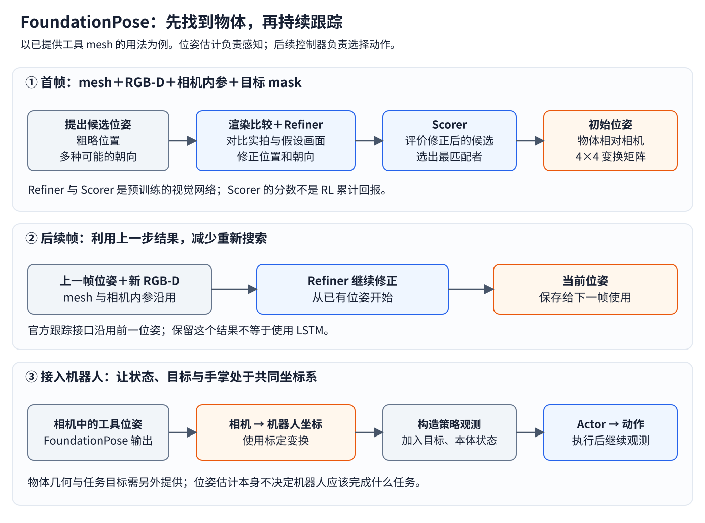

# 视觉状态估计：从 6D 位姿到 FoundationPose

> 阅读位置：基础知识 F05。本文补充 [SimToolReal 精读](49_simtoolreal_paper_walkthrough.md) 所需的视觉知识，依次回答“策略为什么需要感知 → 位姿是什么 → FoundationPose 怎样工作 → 如何接到机器人”。不要求先学会计算机视觉或三维几何。

> FoundationPose：Bowen Wen 等，CVPR 2024。[官方项目页](https://nvlabs.github.io/FoundationPose/)、[论文](https://arxiv.org/abs/2312.08344)、[代码](https://github.com/NVlabs/FoundationPose)。本文核对日期为 2026-11-01；代码说明参考官方 `run_demo.py` 和 `estimater.py`，不将其中的默认设置视为所有系统的统一要求。

## 1. 为什么读 RL 论文会遇到 FoundationPose？

因为有些 RL 策略接收的是“物体位置、朝向”等数值。仿真器可以直接给出这些数；到了真实机器人上，就需要传感器和感知算法来估计。

~~~text
仿真：仿真状态 → 构造数值观测 → Actor → 动作
真机：相机图像 → 估计物体状态 → 构造数值观测 → Actor → 动作
~~~

**FoundationPose 是刚性物体的位姿估计与跟踪方法。** 它回答“这个物体在哪里、朝向哪里”，让控制器获得可使用的状态；动作选择仍由控制器负责。[官方介绍](https://nvlabs.github.io/FoundationPose/)

因此，它与 RL 可以配合，但不是 PPO 那样的学习算法，也不是每个 RL 系统的必备模块。SimToolReal 使用外部位姿跟踪；HORA 的部署策略则依赖本体感知历史。还有些策略直接接收图像或点云，不显式经过同样的位姿接口。应根据论文的部署观测判断是否需要它，不能由“用了 RL”推出“用了 FoundationPose”。

## 2. 先认识几个输入与输出

### 2.1 6D 位姿：位置＋朝向

拿桌上的锤子举例：

- **位置**：选定的工具原点在哪里，用 x、y、z 三个数描述。
- **朝向**：锤柄指向哪里、锤头朝哪侧，用一个三维旋转描述。

位置有 3 个自由度，朝向有 3 个自由度，合起来称为 6D pose。但“6 个自由度”不规定数据必须存成 6 个数：

| 表示 | 存储形式 | 初读时怎样理解 |
| --- | --- | --- |
| 位置＋欧拉角 | 3＋3 个数 | 三个位置分量，加一组约定顺序的旋转角 |
| 位置＋单位四元数 | 3＋4 个数 | 四元数的四个分量受约束，共同表示一个旋转 |
| 齐次变换矩阵 | 4×4 矩阵 | 将旋转和平移放在同一个矩阵里，便于变换坐标 |

四元数只需先记住：它是朝向的一种编码，不是四个独立旋转角。不同代码还可能使用 `xyzw` 或 `wxyz` 顺序，接入模型时必须确认。

### 2.2 RGB-D、mask、mesh 分别提供什么？

| 数据 | 直观含义 | 它没有直接告诉你什么 |
| --- | --- | --- |
| RGB | 彩色照片 | 物体的真实深度与尺度 |
| Depth | 与图像对应的深度值 | 哪些像素属于你想跟踪的工具 |
| Mask | 标出目标物体像素的分割结果 | 物体完整三维形状和朝向 |
| Mesh | 用顶点、三角形面描述的三维表面模型 | 这个物体此刻在相机前的位姿 |
| Pose | 物体坐标到指定参考坐标的变换 | 机器人下一步应执行的动作 |

可以把 mesh 想成“这把工具的三维形状档案”，pose 则是“这份形状档案现在应该放在哪里、转向哪里”。同一把刚性工具运动时，mesh 不变，pose 改变。

## 3. 为什么还要相机参数和坐标标定？

### 3.1 相机内参：把像素与空间方向联系起来

像素坐标表示图像上的位置，并不是米。相机内参描述成像关系，例如焦距和主点；结合深度，才能把图像中的像素反投影为相机坐标系下的三维点。

所以，“这个点在图像右侧”和“这个点在机器人右边 10 cm”之间，还隔着深度、相机成像模型和坐标转换。

### 3.2 相机到机器人的标定：让大家使用同一个参考系

桌边的相机与机器人朝向不同。FoundationPose 输出工具相对相机的位姿，控制器却可能需要工具相对机器人基座的位姿。设 \(T_{A\leftarrow B}\) 表示把 B 系中的坐标转换到 A 系，则：

\[
T_{\mathrm{base}\leftarrow\mathrm{object}}
=T_{\mathrm{base}\leftarrow\mathrm{camera}}
\,T_{\mathrm{camera}\leftarrow\mathrm{object}}.
\]

右边第二项来自视觉估计，第一项来自相机与机器人之间的标定。相机固定安装时，第一项通常可以预先获得；相机随机器人运动时，还需要结合机器人运动更新对应关系。

**当前工具、目标工具、手掌必须使用可比较的坐标约定，才能相减得到有效误差。** 工具原点选在柄中心还是整个 mesh 中心，也要保持一致。仅仅让两个数组都有 3 个位置数、4 个四元数，并不能保证可以直接比较。

## 4. FoundationPose 怎样估计位姿？

先看已有工具 mesh 的使用方式。官方示例的接口可以概括为：

~~~text
事先准备：目标工具 mesh、相机内参
首帧输入：RGB + Depth + 目标 mask
输出：物体在相机坐标系中的 4×4 位姿矩阵

后续帧：新 RGB-D + 上一帧位姿 → 更新后的位姿
~~~

这对应官方示例中的初始化 `register()` 与逐帧跟踪 `track_one()`。[示例源码](https://github.com/NVlabs/FoundationPose/blob/main/run_demo.py)

[放大流程图](../assets/figures/foundationpose-pipeline.svg)。图中假设工具 mesh 已经准备好。

### 4.1 首帧：提出候选，修正候选，再选最好的

直观过程如下：

1. **粗略定位，提出不同朝向。** 利用 mask 和深度估计物体的大致位置，再生成多个候选位姿。
2. **按候选位姿渲染工具。** 假设工具真处于这个位姿，它在相机里应该呈现什么颜色、轮廓和深度？
3. **Refiner 比较并修正。** 把渲染结果与实拍观测对比，预测如何调整位置和朝向；可以迭代细化。
4. **Scorer 对候选评分。** 从修正后的候选中选择更符合观测的位姿。

这就是 render-and-compare 的直觉：用已知形状生成“假设画面”，再检查它与实拍是否吻合。Refiner 与 Scorer 是学习得到的网络，不是单纯手写的像素相减规则。[方法论文 §3](https://arxiv.org/html/2312.08344v2)

Scorer 虽然也输出分数，但分数评价的是**候选位姿与视觉观测的匹配**；RL Critic 评价的是**未来累计回报**。二者不能因为都“打分”就当成同一模块。

### 4.2 后续帧：从上一帧结果继续跟踪

如果上一帧已知道工具在哪里，下一帧可以从这个结果出发，用新图像继续修正。官方 `track_one()` 沿用前一位姿并调用 Refiner，通常不在每帧重新执行完整候选搜索与评分流程。[跟踪源码](https://github.com/NVlabs/FoundationPose/blob/main/estimater.py)

这解释了 estimation 与 tracking 的区别：前者需要建立初始位置和朝向，后者利用已有结果持续更新。沿用上一帧位姿也不等于使用 LSTM；两者保留历史信息的方式不同。

## 5. 它是否也要训练？新工具需要重新训练吗？

**FoundationPose 的位姿网络有自己的预训练。** 原论文使用大量合成场景与已知真值来学习位姿修正和候选选择。这与机器人通过任务 reward 学控制策略，是两项不同的训练。[论文的训练与方法部分](https://arxiv.org/html/2312.08344v2)

部署到新物体时，可以复用预训练的位姿网络，但仍需要提供关于新物体的几何信息。官方区分两种设置：

| 设置 | 新物体要准备什么 | 需要避免的误解 |
| --- | --- | --- |
| Model-based | CAD 模型或重建的 mesh | “不用重新训练位姿网络”不等于“不用准备物体模型” |
| Model-free | 带相关相机／位姿信息的参考 RGB-D 视图，用于建立对象表示 | 仍有对象建模过程；不能理解为随便一张未知图片就具备全部信息 |

Model-free 路线通过拟合该物体的神经表示，支持后续渲染与位姿估计。这里的 “model” 指物体几何／外观模型，与 RL 中是否学习动力学模型的 model-free／model-based 分类含义不同。[官方项目说明](https://nvlabs.github.io/FoundationPose/)、[参考视图与运行说明](https://github.com/NVlabs/FoundationPose)

SimToolReal 先通过 SAM 3D 得到工具 mesh，再把它交给 FoundationPose。RL 训练时并不对这套视觉模型反向更新；真机运行时也不靠 RL reward 重新学习位姿网络。

## 6. 回到 SimToolReal：谁负责哪一个量？

| 所需信息 | 负责模块 | 结果进入哪里 |
| --- | --- | --- |
| 图像中的工具／柄／头区域 | SAM 2，配合用户提示 | 后续重建和部件处理 |
| 工具三维外形与真实尺度 | SAM 3D，结合实测深度 | 位姿跟踪用的 mesh、抓握框计算 |
| 工具在每帧的位置和朝向 | FoundationPose | 视频中的目标轨迹，或真机当前状态 |
| 抓握区域尺寸 | 部件几何处理 | Actor 的几何条件 |
| 手臂和手指怎样运动 | RL Actor | 控制命令 |

完整的顺序与半自动处理细节见 [SimToolReal 第 5 节](49_simtoolreal_paper_walkthrough.md)。这个分工有助于定位问题：抓握框错误要查部件与尺度；当前位姿漂移要查跟踪；观测正确却动作不合适，再分析控制策略。

“位姿是特权信息吗”也由此得到答案：仿真真值可能只在训练中存在；真实相机输出的位姿估计可以作为部署观测。两者描述同一种物理量，却具有不同的误差、延迟和可获得条件。相关训练安排见 [RL03](45_teacher_student_and_sim_to_real.md)。

## 7. 阅读这类系统时，还需要检查什么？

下面是根据输入与跟踪机制需要检查的工程条件，不是对所有场景的失败率统计：

| 条件 | 对控制的影响 |
| --- | --- |
| 物体被手遮挡、移出画面 | 可用视觉证据减少，跟踪可能丢失 |
| 外形或纹理高度对称 | 某些朝向在图像中难以区分 |
| 深度质量差、mesh 尺寸不准 | 位姿和关键点可能出现系统误差 |
| 相机标定或物体原点不一致 | 感知结果看似合理，控制误差却不正确 |
| 图像处理有延迟 | Actor 使用的是稍早的物体状态 |

SimToolReal 将位姿跟踪丢失列为主要失败来源，说明感知误差会进入闭环。它报告的 30 Hz 是该系统中的运行配置，不是 FoundationPose 在任意硬件和设置下的固定速度。[SimToolReal v2 §III-C、附录 G](https://arxiv.org/abs/2602.16863v2)

初读后，应能说明这条路径：**图像与物体模型 → 位姿估计 → 坐标变换 → 当前状态与目标误差 → 控制动作**。继续阅读 [SimToolReal](49_simtoolreal_paper_walkthrough.md) 时，再把每个模块对应到它实际需要的观测即可。
