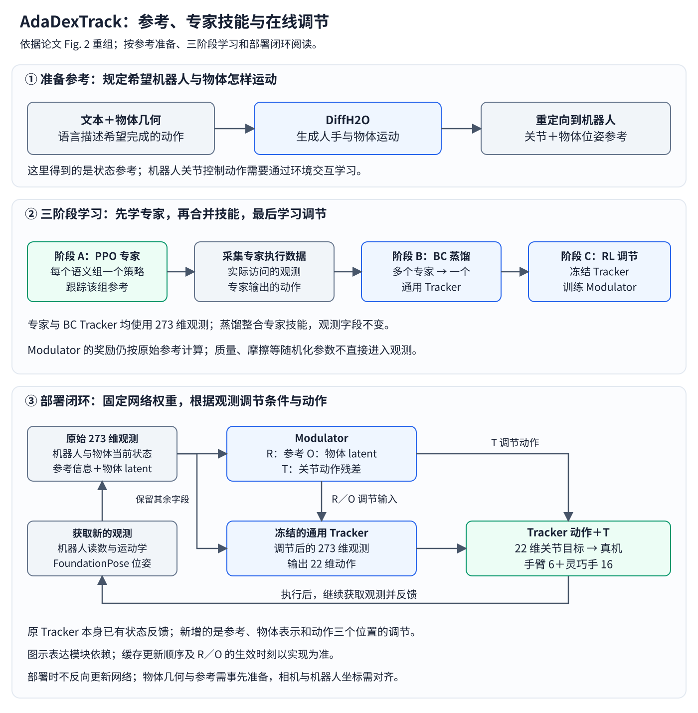

# AdaDexTrack 精读：先学会跟踪，再根据执行状态调整

> 阅读前提：看过 [HORA](46_hora_paper_walkthrough.md)、[UniDexGrasp](47_unidexgrasp_paper_walkthrough.md) 或 [SimToolReal](49_simtoolreal_paper_walkthrough.md)，知道 Actor 根据观测输出动作即可。本文依次回答：参考从哪来、Teacher 怎样学、Student 学什么、Modulator 改哪里，以及实验究竟支持什么。

> 论文：Jianibieke Adalibieke 等，*AdaDexTrack: Dynamic Modulation for Adaptive and Generalizable Dexterous Manipulation Tracking*。以用户提供的 [arXiv v1](https://arxiv.org/abs/2610.33852v1) 为准；[PDF](https://arxiv.org/pdf/2610.33852v1)、[官方项目页](https://janebek.github.io/AdaDexTrack/)。整理更新：2026-11-01。论文实验与公开代码分开说明；代码固定为 [`9ca0c03`](https://github.com/Janebek/AdaDexTrack/tree/9ca0c03060e1212e3f3df72e91910ac522bfd6ee)。

| 遇到的疑问 | 前置入口 |
| --- | --- |
| PPO 如何用奖励训练 Actor、Critic？ | [RL02：RL 训练闭环](44_rl_basics_and_training_loop.md) |
| Teacher–Student 与 Actor–Critic 有什么区别？ | [RL03：训练角色与部署](45_teacher_student_and_sim_to_real.md) |
| 位姿、四元数和 FoundationPose 是什么？ | [F05：视觉状态估计](50_visual_state_estimation_and_foundationpose.md) |
| success、completion 和消融应该怎样读？ | [RL05：RL 实验阅读](48_rl_experiment_reading.md) |

## 1. 它想解决什么问题？

**AdaDexTrack 学习跟踪“手与物体一起运动”的参考轨迹，并根据实际执行情况调整跟踪过程。**

例如，参考要求“手指合拢 → 抓住物体 → 转动”。实际机器人可能还没抓稳，参考就已进入转动阶段。参考本身也可能存在生成误差，或者人类手能完成的姿势不适合机器人手。只顾着追逐参考，偏差就可能不断扩大。

论文的关键判断是：**已经学到的跟踪技能可以保留，再增加一个根据反馈调整参考、物体表示和动作的模块。** 整体流程可以先记成：

~~~text
文本与物体几何 → 人类手／物体参考 → 重定向为机器人参考
                                      ↓
                         多个 PPO 专家 Teacher
                                      ↓ 收集实际控制动作
                           一个 BC 通用 Tracker
                                      ↓ 冻结 Tracker
                         用 RL 训练 Modulator
                                      ↓
               部署：Tracker 与 Modulator 配合控制机器人
~~~

它与 SimToolReal 的起点不同：SimToolReal 先学习随机工具目标控制，人类视频在部署前指定任务；AdaDexTrack 在训练时就使用参考轨迹，学习机器人如何通过真实的物理交互跟随它们。

## 2. 参考轨迹来自哪里？为什么这还需要 RL？

### 2.1 文本生成运动，再重定向到机器人

论文使用已有的 DiffH2O 生成人类手与物体的交互运动。GPT-5 负责把已有文本描述改写成语义相近的表达，再由 DiffH2O 生成对应运动。GPT-5 没有直接输出机器人控制指令。

之后，利用人手与机器人手的关键点对应关系，通过优化匹配这些点，把人类动作重定向成 xArm6＋LEAP Hand 的参考运动。参考包含机器人关节、手部位姿和物体位姿随时间的变化。

数据经历两次筛选：1,333 条带文本的候选中保留 505 条满足单手操作、无相关碰撞、机械臂可达等条件的参考；每条加入至多 9 个文本改写生成的变体，形成至多 5,050 条候选，再筛选得到 **2,765 条有效参考，覆盖 50 个物体**。

### 2.2 参考状态不等于可以直接执行的动作

参考说明“希望机器人和物体处于什么状态”。它并没有保证：把这些关节角直接发给电机，物体就会沿着参考运动。物体能否移动，还取决于接触位置、摩擦、抓握是否稳定等因素。

因此，Teacher 需要在物理仿真里学习：面对当前状态，应该怎样控制，才能让后续状态更接近参考。

| 数据 | 具体内容 | 在方法里的用途 |
| --- | --- | --- |
| 生成并重定向的参考 | 希望达到的关节配置、手部和物体位姿 | 给 RL 指定目标，计算跟踪奖励 |
| Teacher 实际执行的数据 | 当时的观测，以及 Teacher 输出的 22 维控制动作 | 给 Student 提供 BC 动作标签 |

所以，这里的 RL 确实带有“模仿参考运动”的目标；它仍然通过奖励和环境交互学习控制。后面的 BC 才直接拟合 Teacher 的动作。

## 3. 三个训练阶段：谁在学，谁被冻结？

[放大流程图](../assets/figures/adadextrack-pipeline.svg)。对应论文 Fig. 2 与附录的训练、部署接口；图中的箭头表示职责和数据依赖，具体缓存时序见第 6 节。

### 3.1 用 PPO 训练专门的 Tracker

每个 Teacher 从随机初始化开始，在自己的参考集合上反复训练：读取当前状态和参考，输出动作，仿真推进，再根据结果计算奖励。

奖励主要鼓励手臂与手指关节、手掌、指尖和物体接近各自参考，同时让手与物体保持接近，在满足条件时给额外奖励。误差越大应受到越强惩罚；正文 Eq. 1 中的误差项需要结合附录的权重、截断和门控理解，不能读成“误差越大，奖励越高”。

Teacher 使用 PPO 的 Actor–Critic 训练：Actor 决定动作，Critic 估计回报。控制动作是 **22 维关节位置目标增量：6 维机械臂＋16 维手指**，经缩放、累积和限幅后交给底层关节控制器。

### 3.2 用 BC 把多个专家合成一个通用 Tracker

让各个训练好的 Teacher 执行其参考，收集观测与动作，再训练一个 Student，让它输出相近的动作。Student 就是后续使用的通用 Tracker。

**Teacher 与 Student 的观测字段相同。** 这里蒸馏的作用是整合多个专家的技能，区别于 HORA 用历史替代特权 latent，也区别于 UniDexGrasp 转换完整状态与视觉观测接口。

论文选择离线 BC，并说明向大量专家反复查询 DAgger 标签会增加训练成本。这是一项训练组织选择；论文没有通过 BC 与 DAgger 的直接消融证明 BC 的控制效果更好。

版本边界：正文将蒸馏数据描述为成功轨迹；固定版本的[公开采集文档](https://github.com/Janebek/AdaDexTrack/blob/9ca0c03060e1212e3f3df72e91910ac522bfd6ee/docs/bc_training.md)明确保留所有 rollout，包括跟踪失败。复现时需要注明采用哪种数据筛选规则。

### 3.3 冻结 Tracker，再用 RL 训练 Modulator

通用 Tracker 学好后，冻结其网络和观测归一化统计量。另一个 PPO 策略 Modulator 根据当前状态，调整 Tracker 的部分输入和最终动作。此阶段只更新 Modulator。

| 阶段 | 被训练的网络 | 学习信号 | 得到什么 |
| --- | --- | --- | --- |
| 专家训练 | 各个 Tracker 的 Actor、Critic | 跟踪奖励与 PPO | 多个专门的控制策略 |
| 通用蒸馏 | 一个 Student Tracker | Teacher 的动作标签 | 一个覆盖多组参考的策略 |
| 动态调节 | Modulator 的 Actor、Critic | 原任务的跟踪奖励与 PPO | 根据实际状态调整执行的能力 |
| 真机运行 | 无网络更新 | 实时观测用于前向计算 | 每一步重新生成控制命令 |

公开配置使用 MLP：专家 Actor、Critic 为独立的四层 MLP；通用 Tracker 和 Modulator 使用更宽的六层 MLP。它们不依赖 SimToolReal 那样的 LSTM。Modulator 也不是再从 Tracker 蒸馏出来的另一个 Student。

## 4. 到底训练多少个 Teacher，每个跟踪多少条参考？

**一个语义组对应一个 Teacher。** 同一条基础示范及其文本改写产生的参考归为一组，因此每个 Teacher 跟踪的是一小组相似参考，而非固定一条轨迹，也非一个物体类别的全部轨迹。

论文给出数据划分，固定版本的语义分组与[训练文档](https://github.com/Janebek/AdaDexTrack/blob/9ca0c03060e1212e3f3df72e91910ac522bfd6ee/docs/bc_training.md)给出专家数量：

| 独立实验 | 训练参考 | 训练 Teacher | 蒸馏结果 | 测试参考 |
| --- | --- | --- | --- | --- |
| 未见轨迹 | 2,212 条 | 435 个 | 一个通用 Tracker | 553 条 |
| 未见物体 | 45 个物体的 2,520 条 | 402 个 | 另一个通用 Tracker | 5 个未见物体的 245 条 |

每个 Teacher 对应 **1～10 条**训练参考；两个划分平均约为 5.1 条、6.3 条。不能把 435＋402 个 Teacher 看作同一个 Student 的教师池，这两组实验分别训练、分别测试。

一条参考会在不同初始化、物理参数和噪声条件下被反复尝试。论文每个专家使用 8,192 个并行仿真环境；这是并行采样规模，不是参考轨迹数量。轨迹条数也不能等同于 RL 的环境交互次数。

## 5. Teacher、Student 和部署的 obs：完整 273 维

### 5.1 所有阶段共享哪些字段？

附录 Table 4 给出以下格式，A.3.2 与 A.4 明确说明通用 Tracker、Modulator 使用同一观测空间。下表索引采用 Python 的“左闭右开”切片；一帧可看成长度为 273 的向量，批量输入为 `[B, 273]`。

| 切片 | 输入字段 | 维度 | 具体含义 |
| --- | --- | --- | --- |
| `0:22` | 当前关节位置 | 22 | 6 个机械臂关节＋16 个手指关节 |
| `22:57` | 手掌与四个指尖的当前位姿 | 35 | 5 个部位，每个位置 3＋四元数 4 |
| `57:64` | 当前物体位姿 | 7 | 位置 3＋四元数 4 |
| `64:71` | 当前物体相对参考的位姿误差 | 7 | 位置差 3＋相对旋转四元数 4 |
| `71:99` | 未来物体参考位姿 | 28 | 未来第 1、2、4、12 步，各 7 维 |
| `99:121` | 当前关节相对参考的误差 | 22 | 22 个关节的当前值减参考值 |
| `121:209` | 未来关节参考 | 88 | 未来第 1、2、4、12 步，各 22 维 |
| `209:273` | 物体几何 latent | 64 | 点云编码器产生的几何表示 |
| **合计** | **当前状态＋当前误差＋未来参考＋物体表示** | **273** | **Teacher、BC Student、Modulator 的共同原始格式** |

这里的“未来第 1、2、4、12 步”是时间索引，不表示物体位姿都写成相对当前位姿的增量。当前物体误差的 7 个数也没有被压成一个距离分数。

公开实现把当前关节和未来关节参考按关节上下限归一化，当前关节误差仍由关节角差构成；位姿使用位置与四元数。部署时必须沿用相同单位、坐标系、关节顺序和归一化规则，不能只凑齐 273 个数。

这张表**没有关节速度、上一动作、物体质量、摩擦系数或 RGB 图像**。未来参考来自已准备的轨迹，并不是预测器实时猜出的未来。

### 5.2 训练和部署分别从哪里获得这些量？

| 字段组 | 仿真训练／BC 数据来源 | 真机部署来源 |
| --- | --- | --- |
| 关节、手掌、指尖状态 | 仿真机器人状态；按实现施加观测噪声 | 机器人关节读数＋正运动学 |
| 当前物体位姿 | 仿真物体状态；观测中加入相应噪声 | RGB-D＋物体 mesh，经 FoundationPose 估计与坐标变换 |
| 当前跟踪误差 | 当前状态与当前参考计算 | 测量／估计状态与当前参考计算 |
| 未来手部和物体参考 | 预先生成并重定向的轨迹 | 读取准备好的机器人参考轨迹 |
| 64 维几何 latent | 物体点云经预训练编码器得到 | 准备物体几何并使用相同编码器／对应 latent |

BC 训练使用收集文件里的上述观测与 Teacher 动作，不在每次梯度更新时重新调用仿真或 FoundationPose。

**Teacher 和 Student 相同的是字段格式；仿真真值与真实估计的质量并不相同。** Teacher–Student 本身也不会消除视觉误差，真机仍依赖持续可靠的物体位姿。

### 5.3 最终部署时，两个网络都直接读取这 273 维吗？

Modulator 读取原始的 273 维观测；Tracker 读取经过参考与 latent 调整的 273 维观测。维数保持不变，但部分字段的内容改变了。Tracker 输出 22 维动作，之后还要叠加 Modulator 的动作修正。

所以，“Teacher 与 Student 的 obs 相同”描述的是蒸馏接口；完整方法部署时，还包含下一节的调节过程。

## 6. Modulator 的三个通道分别改什么？

| 通道 | 改动位置 | 直观理解 |
| --- | --- | --- |
| R：Reference modulation | Tracker 看到的未来物体位姿与关节参考 | 根据当前执行偏差，调整接下来追踪的局部目标 |
| O：Object latent modulation | 输入中的 64 维物体表示 | 调整 Tracker 被条件化的几何表示，影响它选择的动作 |
| T：Positional-target modulation | Tracker 输出的关节目标增量 | 在已有控制动作上补充执行修正 |

R 可以理解为“稍微调整接下来希望手和物体怎样运动”。它并不等于论文另外学习了一个语义任务规划器，也不应直接解释为“动态改变轨迹播放速度”。

O 最容易与 HORA 混淆。这里原始 latent 来自物体点云，Modulator 学习怎样调整它能改善控制；并没有要求每一步都把它估计得更接近真实质量、摩擦或某个物理参数。论文用解码后的几何与手指张开程度作定性分析，不能据此认为每个 latent 维度都有固定物理含义。

T 则直接修正动作。只有 T 作用在动作输出，R 和 O 作用在策略条件上；这就是三个通道之间的区别。

**调节后的参考供 Tracker 使用，奖励仍按原始参考计算。** 因此，不能简单把目标改成“机器人现在的位置”，就凭空获得高奖励。

公开代码的实现边界：默认 Modulator 输出 202 维，分别是 28 维物体参考修正、88 维关节参考修正、64 维 latent 与 22 维动作残差。latent 采用缩放后的替换值；参考和 latent 进入下一次缓存的 Tracker 观测，动作残差作用于当前步。概念图里的“调整后执行”不应掩盖这项具体时序。[固定版本调节接口](https://github.com/Janebek/AdaDexTrack/blob/9ca0c03060e1212e3f3df72e91910ac522bfd6ee/docs/modulator.md)

原 Tracker 本来就根据当前观测闭环行动。论文增加的是参考、表示和动作上的调节；部署时网络权重保持不变，变化的是观测、调节量与控制命令。

## 7. 做了 DR 吗？真机又需要什么？

做了。附录 Table 3 随机化机器人质量、摩擦、关节刚度和阻尼，以及物体质量、摩擦、恢复系数、尺寸和初始位姿，还给观测与动作加入噪声。

| 论文 Table 3 中的例子 | 范围或形式 |
| --- | --- |
| 机器人质量、摩擦、刚度、阻尼 | 标称值的 0.9～1.1 倍 |
| 物体质量、摩擦 | 标称值的 0.7～1.3 倍 |
| 物体尺寸 | 标称值的 0.95～1.05 倍 |
| 物体初始位置、朝向 | 加入随机偏移 |
| 本体感知与动作 | 加入高斯噪声 |

**DR 改变环境；特权观测决定网络能看到什么。** 在不同质量和摩擦下训练，并不要求把随机出的质量和摩擦数值输入 Actor。这里的 273 维表里就没有这些参数。

论文还使用系统辨识，让仿真关节响应接近真实机器人。真实系统是 xArm6、LEAP Hand 和 RealSense D435；用 FoundationPose 估计物体位姿，并完成相机到机器人坐标的标定。

这依然需要物体几何、参考轨迹和可靠感知。主实验排除了会导致连续旋转位姿歧义的轴对称物体；附录再通过添加非对称纹理研究它们。公开配置的部分随机化范围与论文表格不同，复现实验时应分别记录论文设定与实际运行配置。

## 8. 做了哪些实验？特别看消融能证明什么

### 8.1 先分清 Mean-error 与 Completion

Table 1 同时报告物体位置／朝向、手腕位置／朝向、手指关节误差，以及两种成功指标：

| 指标 | 计算方式 | 如何理解 |
| --- | --- | --- |
| Mean-error | 先求每条轨迹的平均误差，再统计通过阈值的轨迹比例 | 一条轨迹整体平均跟得是否足够接近 |
| Completion | 先统计每条轨迹中满足误差阈值的帧比例，再跨轨迹平均 | 多少比例的时间处于合格跟踪状态 |

阈值同时要求：物体与手腕位置误差的平均不超过 10 cm，二者旋转误差的平均不超过 60°，手指平均关节误差不超过 40°。Table 1 的旋转误差列使用弧度，读表时要与阈值的角度单位区分。

**Completion 不是“完整完成所有动作的实验次数比例”。** 例如 52.36% 的 Completion，不能改写成“52.36% 的真机任务完整成功”。它也不同于 SimToolReal 按顺序到达工具目标的 Task Progress。

### 8.2 仿真：未见轨迹、未见物体与三通道消融

Table 1 的主要消融如下，单元格均为 **Mean-error / Completion（%）**：

| 方法 | 未见轨迹 | 未见物体 |
| --- | --- | --- |
| 通用 BC Tracker | 62.20 / 65.01 | 24.08 / 42.52 |
| Tracker＋R | 67.09 / 68.14 | 25.71 / 42.89 |
| Tracker＋R＋T | 84.45 / 80.42 | 37.55 / 47.51 |
| Tracker＋R＋O＋T | **88.99** / 77.92 | **46.12 / 53.78** |

这个结果支持：在所测设置中，完整调节器相比纯 BC Tracker 有明显收益，未见物体尤其困难。但加入 O 后，未见轨迹 Completion 从 **80.42% 降至 77.92%**，部分姿态和关节误差也变差。因此，不能写成“三个通道让每项指标都逐步提升”。

定量消融没有穷举 T-only、O-only、R＋O 等全部组合。已有结果能够比较这些实际配置，无法完整分离三个通道的独立作用与交互作用。

论文还比较 ObjDex、DexTrack 和直接训练通用 PPO 的方法。完整方法的两种指标分别为未见轨迹 88.99 / 77.92、未见物体 46.12 / 53.78；对应 DexTrack 为 76.13 / 73.89、39.59 / 47.37。需要同时注明：作者的 DexTrack 复现没有包含 homotopy 示范挖掘，ObjDex 的高层规划器也经过重新实现。

### 8.3 真机：主要比较有无 Modulator

Table 2 使用未见轨迹的 15 个物体、60 条参考，以及未见物体的 2 个物体、20 条参考，报告 Completion：

| 配置 | 未见轨迹 | 未见物体 |
| --- | --- | --- |
| 通用 Tracker，无 Modulator | 26.63% | 22.27% |
| 完整方法 | **52.36%** | **36.71%** |

这支持调节器在真实系统中的整体价值。该表没有分别拆开 R、O、T 的真机收益，未见物体也只有两个实例，不能把结果扩展成任意物体、任意任务的保证。

### 8.4 其他实验与还未被单独证明的部分

| 实验 | 回答的问题与边界 |
| --- | --- |
| Fig. 4、5 | 展示参考如何调整，以及几何 latent 如何影响动作；属于定性机制分析 |
| Fig. 6 数据规模 | 增加训练数据整体上有帮助，未见物体收益趋于饱和；不等于每一段曲线都严格单调 |
| 附录 Table 6 | 8 个添加纹理的轴对称物体上，Completion 从 29.72% 提升至 58.61%；仍依赖稳定的位姿估计 |
| 附录 Table 7 | 去掉物体防滑胶带后，完整方法仍优于无调节器；未见物体 32.50% 低于主实验 36.71%，不能说去胶带所有条件都更好 |
| 附录 Table 8 | 测试重建几何和单视角部分点云；部分几何更难，不能推导出完全不需要 mesh 或位姿估计 |
| 附录 Fig. 12 | 小幅 latent 扰动下动作响应较平滑；这不是全局稳定性的数学证明 |

论文没有单独给出无 DR、不同 Teacher 数量，或 BC 对 DAgger 的消融。某项设计被使用，与其独立价值已经被实验分离，是两件事。

## 9. 这篇论文怎样讲故事，贡献和边界在哪里？

可以用四句话串起来：

1. **问题：**生成参考、重定向和实际接触存在偏差，长时跟踪容易积累错误。
2. **判断：**已有通用 Tracker 包含可复用技能，根据执行状态调节其参考、物体表示和动作，可以改善适应性。
3. **方法：**PPO 专家到 BC 通用策略，再冻结 Tracker，训练与原任务目标一致的三通道调节器。
4. **证据：**对照未见轨迹、未见物体和真机表现，并通过部分通道消融观察收益与取舍。

贡献主要落在**如何组织已学技能和反馈调节**，以及连接参考生成、控制和真实部署的整套验证。PPO、BC、MLP、DiffH2O 和 FoundationPose 都是已有工具。

它也有清楚的边界：参考运动可能不够可行，物体位姿可能丢失或歧义，接触与真实动力学仍有差距，测试对象数量也有限。更低的跟踪误差并不自动保证物体操作达到了全部功能性要求。

对后续研究，一个可检验的切入点是先定位失败：来自感知、参考可行性、轨迹与接触进度不匹配，还是通用 Tracker 缺少相关技能？确定原因后再选择改观测、参考或动作。单纯增加模块，无法替代这种诊断。

## 10. 放回 HORA、UniDexGrasp、SimToolReal 中比较

| 论文 | 核心控制问题 | 知识迁移／适应方式 | 任务如何指定 |
| --- | --- | --- | --- |
| [HORA](46_hora_paper_walkthrough.md) | 未知物体属性下持续手内旋转 | 历史适应模块替代特权 latent | 训练定义的旋转任务／目标 |
| [UniDexGrasp](47_unidexgrasp_paper_walkthrough.md) | 多种物体上的多样抓取与执行 | PPO Teacher 到视觉条件 Student | 一个目标抓姿 |
| [SimToolReal](49_simtoolreal_paper_walkthrough.md) | 新工具上的目标位姿控制 | 同一个带记忆 Actor 直接部署 | 工具目标位姿序列 |
| AdaDexTrack | 手与物体的参考运动跟踪 | 多个专家到通用 Tracker，再用 Modulator 调节 | 当前及未来的手／物体参考 |

**Teacher–Student 可以用于替换信息来源，也可以用于整合多个技能。** AdaDexTrack 属于后者，所以 Teacher 与 Student 的 obs 格式相同，并不矛盾。

## 11. 回答这些问题，就抓住了主线

| 问题 | 回答 |
| --- | --- |
| 参考从哪来？ | DiffH2O 根据文本和物体生成运动，再重定向为机器人参考 |
| 为什么还用 RL？ | 状态参考没有保证可执行的接触动作，需要通过物理交互学习 |
| Teacher 是一条轨迹一个吗？ | 一个语义组一个，每组包含 1～10 条参考 |
| Student 为什么也要物体位姿？ | 这里蒸馏技能，观测格式保持一致；真机通过视觉估计位姿 |
| 273 维包括随机的质量和摩擦吗？ | 不包括；DR 改环境，不要求把参数作为输入 |
| Modulator 更新 Tracker 权重吗？ | 不更新，只改变其部分输入与最终动作 |
| 在线适应等于现场反向传播吗？ | 不等于；部署持续重新计算调节量，网络权重固定 |
| 完整方法是否每个指标都最好？ | 不是，尤其要注意未见轨迹加入 O 后的 Completion 下降 |

代码阅读顺序可沿数据流进行：[语义专家](https://github.com/Janebek/AdaDexTrack/blob/9ca0c03060e1212e3f3df72e91910ac522bfd6ee/docs/specialists.md) → [采集与 BC](https://github.com/Janebek/AdaDexTrack/blob/9ca0c03060e1212e3f3df72e91910ac522bfd6ee/docs/bc_training.md) → [273 维观测与奖励](https://github.com/Janebek/AdaDexTrack/blob/9ca0c03060e1212e3f3df72e91910ac522bfd6ee/adadextrack/envs/tracking_env.py) → [调节器接口](https://github.com/Janebek/AdaDexTrack/blob/9ca0c03060e1212e3f3df72e91910ac522bfd6ee/docs/modulator.md) → [真实观测与控制接口](https://github.com/Janebek/AdaDexTrack/blob/9ca0c03060e1212e3f3df72e91910ac522bfd6ee/docs/sim2real.md)。
