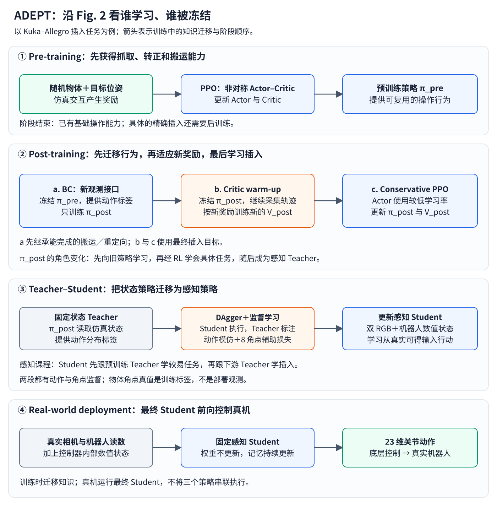
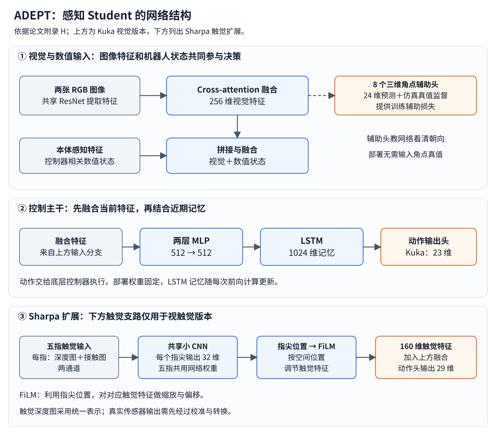

# ADEPT 精讲：沿 Fig. 2 理解预训练、后训练与感知蒸馏

> 阅读前提：知道 Actor 根据观测选择动作、Critic 估计未来回报即可。本文沿 Fig. 2，用“从桌面抓起零件、调整朝向、插入孔中”这一个例子，逐步说明每个阶段输入什么、怎样学习、更新谁，以及最终部署哪个网络。

> 论文：Jayjun Lee 等，*ADEPT: Accelerating Dexterity via Pre-Training and Post-Training using Reinforcement Learning*。以本次提供的 31 页 PDF 为准；[官方 PDF](https://adept-dexterity.github.io/ADEPT.pdf)、[项目页](https://adept-dexterity.github.io/)。整理日期：2026-11-01。方法与维度按正文、附录及 Table 6／7 核对，不把论文中的 codebase 描述当作已经复核发布代码。

| 遇到的疑问 | 前置入口 |
| --- | --- |
| Actor、Critic、advantage 与 PPO 怎样联系？ | [RL02：RL 训练闭环](44_rl_basics_and_training_loop.md) |
| Teacher–Student、BC 和 DAgger 分别是什么？ | [RL03：训练角色与部署](45_teacher_student_and_sim_to_real.md) |
| 两阶段学习与直接部署有什么区别？ | [SimToolReal 精读](49_simtoolreal_paper_walkthrough.md)、[AdaDexTrack 精读](51_adadextrack_paper_walkthrough.md) |
| 消融与成功率应该怎样读？ | [RL05：RL 实验阅读](48_rl_experiment_reading.md) |

## 1. 先对齐 Fig. 2：三个策略，四个大阶段

**ADEPT 先用 RL 学通用操作能力，再迁移到具体任务，最后把状态策略蒸馏成直接读取相机、机器人状态及可选触觉的感知策略。**

以插入为例，机器人需要完成“接近 → 抓取 → 举起 → 调整朝向 → 搬运 → 对齐插入”。如果每个新任务都从随机动作开始，前面的抓取和搬运也要重新学习。ADEPT 希望复用这部分基础能力，并解决继续训练时已有行为迅速退化的问题。

先认清图中的符号：

| 符号 | 对应什么 |
| --- | --- |
| `π_pre` | 预训练得到的通用 Actor |
| `π_post` | 面向下游具体任务的 Actor |
| `π_student` | 最后部署的感知 Actor |
| `V_pre`、`V_post` | 对应任务的 Critic，预测未来累计回报 |
| `o`、`r` | 观测与环境奖励 |
| `L_BC`、`L_aux` | 动作模仿损失与辅助预测损失 |

[放大训练图](../assets/figures/adept-training-stages.svg)。三个策略之间的箭头表示**训练中的知识迁移**。真机执行时只运行最终 Student 与底层控制系统，并不把三个策略依次串起来执行。

| Fig. 2 中的位置 | 这一阶段要得到什么 |
| --- | --- |
| 1：Pre-training | 会抓取、搬运、手内重定向的通用策略 |
| 2：Post-training | 保留基础技能，并学会具体的插入任务 |
| 3：Teacher–Student distillation | 用图像等可部署信息实现相应动作能力 |
| 4：Real-world deployment | 固定网络权重，在真机上闭环执行 |

前面三个阶段都在仿真中完成。下面先沿图中的 Kuka–Allegro 版本讲：7 个机械臂关节＋16 个手指关节，共 23 个自由度。[原文 Fig. 2、§3](https://adept-dexterity.github.io/ADEPT.pdf#page=4)

## 2. 第 1 块：PPO 预训练通用操作策略

这里的 **reposing** 可以理解为：把物体从当前位置和朝向，调整到指定的位置和朝向。它可以包含接近、抓取、举起、手内旋转和搬运。

每回合从 16 种简单几何物体中采样，再随机化尺寸等条件，并指定目标位姿。例如，物体横躺在桌上，目标要求把它举起、转正、搬到指定位置。

~~~text
机器人状态、物体信息、目标 → Actor → 23 维动作 → 仿真执行
                                     ↑                  ↓
                               PPO 更新 ← 奖励、下一状态、Critic 估值
~~~

Actor 通过交互寻找有效动作。奖励鼓励手接近物体、建立相应接触，并让物体接近目标位姿；Critic 学习预测未来回报，训练算法再据此构造 advantage，更新 Actor。

这一步采用 **PPO＋非对称 Actor–Critic**：Actor 读取状态与点云等输入，Critic 还能使用较完整、较干净的仿真信息。论文说明预训练使用共享骨干，但没有像感知 Student 那样完整列出逐层宽度，因此不补猜 Teacher 的 MLP、LSTM 或点云编码器配置。

训练还使用 ADR，即随着成功率提升逐步增加任务难度和随机化强度；PBT 则通过并行策略的比较与调整搜索训练超参数。它们服务于学习过程，不是部署时新增的网络。

**这一块结束后，`π_pre` 已经有可复用的基础技能，但仍需要针对插入继续学习。** 预训练到下游任务的迁移不是“所有新任务都已经零样本完成”。

## 3. 第 2 块：a、b、c 三步完成 post-training

### 3.1 2a：BC Distillation，先把旧技能搬进新观测接口

插入任务的 observation 与预训练不同：增加插孔位姿、物体与插孔接触等信息，同时移除一些预训练字段。因此，作者先建立适配新接口的 `π_post`，让它模仿 `π_pre`。

~~~text
同一个仿真状态
    ├─ 旧观测 → 冻结的 π_pre  → 老师的动作分布
    └─ 新观测 → 待训练 π_post → 学生的动作分布
                                  ↓
                     比较两个分布，只更新 π_post
~~~

**BC，即行为克隆**，用老师的动作作为监督。这里匹配动作分布的均值与标准差等信息；`π_pre` 不随损失更新，Critic 此时也不参与学习。

数据在仿真交互中采集。附录 D 说明执行时会混用 Teacher 与 Student 的动作，不能将其概括成只读取一份固定离线数据。

尤其要注意：**这一步先模仿旧策略能够完成的搬运、重定向目标。** 论文在较容易的 ADR 20 目标上做这段迁移，没有要求旧策略提供它自己不会的成功插入动作。

2a 结束后，新 Actor 适应了新的观测接口，并继承已有行为；插入能力留给后续 RL 学习。

### 3.2 2b：Critic Warm-up，让新的 Critic 熟悉新奖励

作者初始化一个新的 `V_post`，暂时冻结 `π_post`。

原因是任务的评价标准改变了：原任务关注物体到达目标位姿，插入任务还要求对齐、接触并完成插入。新的 Critic 需要学习这个奖励下的累计回报，才能为后续策略更新提供更合适的估值。

~~~text
固定 π_post 的权重
        ↓
在插入任务中执行，采集状态、动作和新奖励
        ↓
构造回报目标，只更新 V_post
~~~

可以理解为：**先让评分员熟悉新的评分标准，再让 Actor 根据评分改变行为。**

冻结 Actor 只表示停止更新网络权重。它仍然根据不同观测产生不同动作，机器人继续交互。此时目标已经切换到最终插入位置，而非 2a 的较容易搬运目标。

2b 结束后，Actor 的行为基本保持不变，新的 Critic 已经开始适应下游任务。[正文 §3.3、附录 D](https://adept-dexterity.github.io/ADEPT.pdf#page=25)

### 3.3 2c：Conservative PPO，小幅修改策略，学习插入

现在解冻 `π_post`，在插入奖励下同时更新 Actor 与 Critic。Critic 学估值，训练算法计算 advantage，Actor 调整动作。

关键安排是把 Actor 学习率从 `1e-3` 降到 `1e-5`，并继续衰减，减小每次参数变化，避免新任务训练迅速破坏已有的抓取和搬运行为。已有能力被新训练破坏，称为**灾难性遗忘**。

论文部署方案还将 PPO clip 从 0.20 收紧到 0.05。clip 约束 PPO 目标中的概率比更新；具体机制见 [RL02](44_rl_basics_and_training_loop.md)。消融显示降低学习率更关键，收紧 clip 本身没有显示必要性，详见第 7 节。

网络上，后训练改用独立的 Actor、Critic 骨干，让价值网络适应新奖励时，减少对 Actor 特征的直接干扰。这里仍然是 PPO，没有另训练一个类似 AdaDexTrack 的外挂 Modulator。

**2c 结束后，`π_post` 成为具体任务的状态策略。** 它在 2a 是向旧策略学习的学生，到下一阶段又成为感知 Student 的老师。Teacher、Student 是阶段中的角色，不是固定的网络类型。

## 4. 第 3 块：把状态 Teacher 蒸馏成感知 Student

### 4.1 Teacher 给动作标签，Student 学习从感知产生动作

| 网络 | 输入 | 这一阶段的职责 |
| --- | --- | --- |
| 冻结的 `π_post` | 仿真状态、物体点云、目标和插孔相关信息 | 给出动作分布标签 |
| 待训练的 `π_student` | 双相机 RGB、机器人本体状态、控制器状态；Sharpa 另加触觉 | 预测相应的动作 |

Fig. 2 的 `o_img` 是感知 Student 整组输入的简称，**并不表示只有图像**。

作者用 DAgger 采集数据：让 Student 自己执行，在它实际访问的状态上查询 Teacher。例如，Student 把零件抓歪了，就在这个状态询问 Teacher 下一步怎样动，再学习相应动作。

这里的 Teacher 标签必须对应“当前抓歪了的状态”。它与 Student 面对同一个仿真状态，只是输入接口不同：Teacher 使用状态信息，Student 使用相机、机器人状态及可选触觉。Teacher 可以只给标签，不必接管实际执行，也不能直接拿原始成功轨迹中同一时间步的动作来监督。

可以先读 [RL03 第 3 节的 DAgger 五步流程](45_teacher_student_and_sim_to_real.md)，再把其中的“执行者、标注者、更新对象”对应到这里。具体初始化、缓存和更新频率要以论文及实现为准；本文的两段感知课程在 §4.3 单独说明。

这样，训练数据包含 Student 自己执行时容易遇到的情况。动作监督仍来自 Teacher，这一步属于交互式模仿学习；**最终 Student 没有在这一步再通过 PPO 优化任务奖励。** 环境负责产生训练样本，监督损失反向更新 Student 的可训练参数；冻结的 Teacher 参与前向标注，仿真器不需要参与反向传播。[§3.4、附录 G](https://adept-dexterity.github.io/ADEPT.pdf#page=5)

### 4.2 Student 网络：图像特征与机器人状态融合，再用记忆决策

[放大 Student 网络图](../assets/figures/adept-student-network.svg)。附录 H 给出以下结构：

| 模块 | 输入与输出 | 直观作用 |
| --- | --- | --- |
| 共享 ResNet | 两路 RGB 分别提取图像特征 | 从图像中提取物体与场景信息 |
| Cross-attention 融合 | 两个视角 → 256 维视觉表示 | 让不同视角的特征相互参考 |
| 可选触觉分支 | 五指触觉 → 160 维表示 | 补充接触信息，仅 Sharpa 使用 |
| 特征融合与 MLP | 视觉、可选触觉、本体表示与控制器状态 → `[512, 512]` MLP | 综合不同来源的信息 |
| LSTM | 1024 维记忆 | 结合近期历史，处理单帧信息不足 |
| 动作头 | Kuka 输出 23 维，Sharpa 输出 29 维动作均值 | 决定关节动作，保留相应动作分布参数化 |

这里的顺序是 **MLP → LSTM → 动作头**。这些明确层宽属于 Student，不能直接套到状态 Teacher 身上。

触觉分支将每指 TacMap 深度图与二值接触图叠成两通道，经共享 CNN 得到每指 32 维特征。再用指尖位置做 FiLM 调制，即根据接触所在的空间位置对特征进行缩放、偏移；五指合计 160 维。真实触觉输出需要转换成相同表示，并非直接将触觉相机原始 RGB 输入策略。[附录 H](https://adept-dexterity.github.io/ADEPT.pdf#page=28)

### 4.3 辅助损失与两段感知课程

单靠动作模仿，视觉网络可能没有学清楚零件朝向，而插入对朝向很敏感。作者在视觉特征上增加一个辅助头，预测物体包围盒的 **8 个三维角点**，用仿真真值监督。

可以分别理解两项损失：

- **动作模仿损失：**教 Student 在当前情况下怎样动。
- **角点辅助损失：**帮助视觉特征表达物体在哪里、朝向哪里。

8 个角点真值是训练标签，不是部署 observation。Student 执行时无需 FoundationPose 提供外部位姿。

Fig. 2 将这个阶段画成一块，实际感知训练还有两段课程：先跟预训练 Teacher 学较容易的抓起、转正任务，再从该 Student 检查点继续训练，跟下游 Teacher 学插入。**两段都包含动作模仿和角点辅助监督**，并非第一段只学视觉、第二段只学动作。[§3.4、附录 G](https://adept-dexterity.github.io/ADEPT.pdf#page=5)

## 5. 第 4 块：部署最终 Student，网络权重固定

真机读取双相机、机器人状态及相关控制状态，Student 前向输出动作，再交给底层控制系统执行。Sharpa 版本另外读取五指触觉。

此时不需要 `π_pre`、状态 Teacher 或 Critic 参与动作生成。Student 权重固定，LSTM 记忆随执行更新。

**真机 zero-shot 指仿真训练完成后无需真机微调。** 下游任务在仿真中的专门训练仍然存在；不同机器人本体、不同下游任务分别训练策略。一份通用预训练起点可以派生多个任务策略，并不等于一个感知 Student 已经覆盖所有任务和机器人。

## 6. 训练与部署的 observation：字段、维数与来源

### 6.1 先看各阶段的接口总数

以下对应论文 Table 6／7 的 FMB 配置。数值维度不包含图像张量或 LSTM 内部记忆；一批观测可写成 `[B, D]`，其中 `B` 为环境数。

| 网络／阶段 | Kuka–Allegro，23 DoF | Flexiv–Sharpa，29 DoF |
| --- | --- | --- |
| 预训练 Actor | 391 | 436 |
| 预训练 Critic | 438 | 477 |
| 后训练 Actor／最终状态 Teacher | 392 | 437 |
| 后训练 Critic | 280 | 487 |
| 感知 Student | **206＋两张 RGB** | **196＋两张 RGB＋五张触觉图** |

Critic 使用干净的机器人状态和额外仿真信息。Kuka 后训练 Critic 去掉了高维点云，保留物体完整状态等信息，因此维数更小；维数大小不能用来判断观测是否更充分。

### 6.2 下游状态 Teacher 具体看什么？

| 输入字段 | Kuka Teacher | Flexiv Teacher |
| --- | --- | --- |
| 机器人关节与手部运动状态 | 76 | 94 |
| 动作记录 | 23 | 29 |
| Fabric 状态：`q、qd、qdd` | 69 | 87 |
| 手部接触信息 | 15 | 18 |
| 物体点云：64 个三维点 | 192 | 192 |
| 物体目标位置＋四元数 | 7 | 7 |
| 插孔／容器位姿 | 7 | 7 |
| 物体与插孔接触力 | 3 | 3 |
| **合计** | **392** | **437** |

Kuka 的 76 维为关节位置 23、关节速度 23、5 个手部部位的位置 15 与线速度 15。这里是 5 个部位，并非五根手指。Flexiv 的 94 维在 Table 7 合写为 29 个关节及 6 个运动学部位的本体状态。

预训练 Actor 没有插孔相关的 10 维输入，但另外读取当前物体位置与朝向 7 维、物体索引字段 1 维、尺度字段 1 维，所以总数为 391／436。下游 Teacher 没有单列当前物体 pose 字段，但仍读取物体点云，不能据此认为它没有物体空间信息。

### 6.3 感知 Student 的训练输入与部署输入

| 输入字段 | Kuka Student | Flexiv Student |
| --- | --- | --- |
| 机器人本体运动状态 | 76 | 94 |
| 动作记录 | 23 | 不使用 |
| Fabric 状态：`q、qd、qdd` | 69 | 87 |
| `nominal delta` | 38 | 不使用 |
| 五个触觉指尖的三维位置 | 不使用 | 15 |
| **数值部分合计** | **206** | **196** |
| RGB | 两张图像 | 两张图像 |
| 触觉 | 不使用 | 五个指尖的触觉图 |

`nominal delta` 是原文字段名，标为关节与手部位置相关的 `23＋15＝38` 维偏差。PDF 没有展开参考基准与计算式，这里保留原名，不猜测它等于物体目标误差或其他控制误差。

Student 不再显式读取物体点云、物体目标位姿、插孔位姿与物体—插孔接触力。图像经编码后再与其他特征融合，`206＋图像` 不能直接当作编码后 MLP 的输入长度。

| 信息 | 仿真训练来源 | 真机部署来源 |
| --- | --- | --- |
| 机器人本体状态 | 仿真状态，加入观测噪声 | 关节读数与正运动学 |
| 控制器状态 | 控制软件计算 | 相应控制软件计算 |
| RGB | 仿真渲染与视觉随机化 | 双相机图像 |
| TacMap 触觉 | 仿真接触几何构造 | 真实触觉输出校准并转换 |
| 角点真值 | 辅助损失的监督标签 | 不作为部署输入提供 |

字段格式、单位、坐标系、归一化和时间关系都需要对齐。论文按图像张量列出输入，触觉分辨率没有在该表具体展开，不补猜统一的 `H×W` 数值。[Table 6／7](https://adept-dexterity.github.io/ADEPT.pdf#page=19)

## 7. 实验如何支持这套训练流程？

Table 3 从同一个预训练检查点出发，每种配置运行 5 个独立种子。ADR 50 是最终课程等级；下表时间只统计达到该等级的种子，Train SR 是训练瞬时成功率，不等同于完整回合评估成功率。

| 后训练配置 | 达到 ADR 50 的种子 | Train SR | 到 ADR 50 的平均时间 |
| --- | --- | --- | --- |
| 完整方案 | 5/5 | 46.0% | 19.9 小时 |
| 去掉 BC | 4/5 | 38.5% | 35.2 小时 |
| 去掉 Critic 预热 | 4/5 | 28.4% | 20.2 小时 |
| 保留 BC／预热，但用高 Actor 学习率 `1e-3` | 0/5 | 0% | 崩溃 |
| 保持低学习率，clip 放宽到 0.20 | 5/5 | 46.8% | 17.6 小时 |

这支持：低 Actor 学习率在所测设置中是防止崩溃的关键；BC 与预热改善效率、效果和稳定性。它不支持“每个组件都不可缺”或“越小的 clip 越好”。预训练本身也有成本：论文例子为 8B 环境步预训练，加约 3B 下游训练；收益来自复用预训练起点，不能只计算后面的 3B 就宣称总成本更低。[Table 3、§4.1](https://adept-dexterity.github.io/ADEPT.pdf#page=8)

Table 4 的真机结果按最终完整任务成功次数统计，每种条件 10 次：

| 机器人与输入 | 任务 | 最终成功 |
| --- | --- | --- |
| Kuka，视觉 | 星形零件插入 | 5/10 |
| Kuka，视觉 | 方形／圆形组合零件插入 | 3/10 |
| Kuka，视觉 | 盘子放入碗碟架 | 6/10 |
| Flexiv，视觉 | 方形／圆形组合零件插入 | 3/10 |
| Flexiv，视觉＋触觉 | 同一类插入任务 | 8/10 |

这些结果支持真实感知部署与触觉反馈的价值，样本规模仍有限。论文还报告单阶段感知蒸馏在两种 Kuka 零件上均为 0/10，对照支持两段感知课程的作用。遮挡下的朝向识别与接触稳定性仍是限制。[§4.2、Table 4](https://adept-dexterity.github.io/ADEPT.pdf#page=10)

## 8. 怎样复述贡献，以及与前几篇的区别？

这篇的学习主线可以连成一条论证：**每个新任务都从零学习基础操作成本高 → 通用 reposing 提供可复用起点 → 直接微调容易遗忘 → 通过观测接口迁移、Critic 预热和小幅 PPO 更新保留技能 → 再通过感知课程得到可部署策略。**

创新主要体现在如何组织预训练能力、下游学习和感知迁移。PPO、BC、DAgger、ResNet，以及借鉴 TacMap／SaTA 的触觉表示，都应与本文具体设计区分。

| 论文 | 可复用的能力怎样进入新场景？ |
| --- | --- |
| [HORA](46_hora_paper_walkthrough.md) | 保留控制策略，用历史适应模块替代特权 latent 的来源 |
| [UniDexGrasp](47_unidexgrasp_paper_walkthrough.md) | 生成目标抓姿，用目标条件策略执行，再迁移到视觉输入 |
| [SimToolReal](49_simtoolreal_paper_walkthrough.md) | 同一个目标控制器接收新工具几何与目标序列 |
| [AdaDexTrack](51_adadextrack_paper_walkthrough.md) | 多专家蒸馏为通用 Tracker，再用调制器调整执行 |
| ADEPT | 复用预训练起点，为具体任务继续训练，再蒸馏为感知策略 |

读 Fig. 2 时，最后检查每一小步的更新对象：

| 位置 | 学习信号来自哪里？ | 更新谁？ |
| --- | --- | --- |
| 1：预训练 | 通用任务奖励＋PPO | 预训练 Actor、Critic |
| 2a：BC | 预训练 Actor 的动作标签 | 下游 Actor |
| 2b：预热 | 新任务下的回报目标 | 新 Critic |
| 2c：继续 RL | 新任务奖励＋PPO | 下游 Actor、Critic |
| 3：感知蒸馏 | Teacher 动作＋角点真值 | 感知 Student |
| 4：真机部署 | 实时观测用于前向计算 | 不更新网络权重 |

图中的锁标明当前步骤固定谁的权重；被冻结的网络仍然可以前向运行。把“谁提供信息、谁提供监督、谁被更新”分开，便能同时理解 Actor–Critic、Teacher–Student 和 Fig. 2 的各个阶段。
